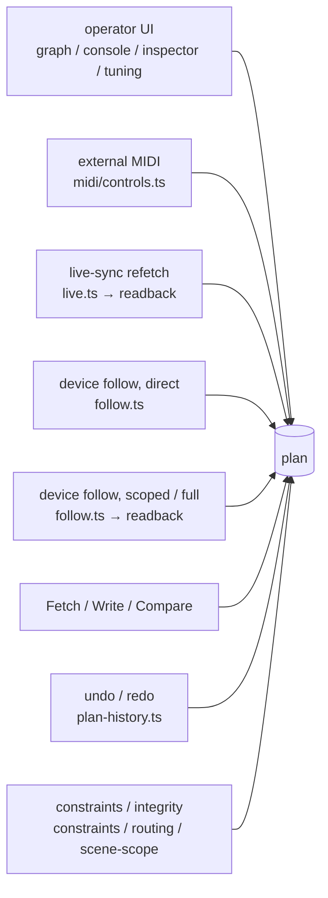

# Live-sync race diagnosis harness

> 日本語版: [../ja/live-race-harness.md](../ja/live-race-harness.md)

Design for the instrumentation harness that systematically detects the defects where, during Live
sync, an operator's edit is overtaken by a device-originated readback, or is absorbed by a snapshot
re-base and never sent.

The history of the findings this harness confirmed and the fixes it drove is kept in the project's
private notes.

## Background — why not fix them one at a time

While Live sync is up, eight independent writers mutate one shared, mutable `plan` object. There is
no per-key ownership, no version stamp, and no record of who wrote last.



Three of those — refetch, follow and Fetch — have hundreds of milliseconds to seconds between the
moment they start reading and the moment they write. `readback.ts` assigns a whole node at a time,
so an operator edit landing mid-read is silently overwritten. When the snapshot is then re-captured,
that edit is not even a diff any more: it never reaches the device.

The same shape is not specific to the EQ 1-knob. It holds equally for the COMP 1-knob, `compEqType`,
the insert-FX selector, MIDI pickup, and every call site of `captureSnapshot`. Fixing them one by one
costs a hardware session each and leaves no proof that the fix holds.

## Stages

| Stage | Content |
| --- | --- |
| 1 | Trace bus + frontend taps + contract test + the `ci.yml` drop guard |
| 2 | Offline analyzer + the invariants |
| T-1 | The fake device, and its own conformance case |
| 4 | Scripted-gesture driver + CI job |
| 5 | Hardware calibration, and a fix per violation the analyzer reports |

Skipping T-1 makes the T0 floor meaningless: the fake must be shown, by its own log, to produce the
latency, notify behavior and refusals it was asked for.

**Stage 3 (Rust-side timestamps and `performance.now()` / `Instant` clock alignment) was dropped.**
No Rust runs anywhere in this harness's path — the fake replaces `window.__TAURI_INTERNALS__` outright,
so a timestamp on `ParamUpdate` / `MeterUpdate` is reachable from no case and read by nothing. Worse,
`ParamUpdate` derives `PartialEq` and that equality is what identifies `BULK_CHANGE`, so a time field
would break the comparison's meaning. Where a real round trip spends its time belongs to the self-test
/ Compare diagnostics, which already measure elapsed time. **Instrumentation only means something when
it has something to measure**, so this stage is dropped rather than deferred.

## Settled decisions

- **Observability**: a `VITE_TRACE=1` build (the same build-flag mechanism as `VITE_DEMO`) produces a
  production-shaped bundle that includes the probe, served only to the instrumented tier. The existing
  production-served E2E suite is untouched, and since the normal build carries no probe the `ci.yml`
  drop guard still holds
- **Implement the Tauri event plugin in the fake** (`transformCallback` + `plugin:event|listen`).
  Without it `dropzone.ts` registers no DOM handlers and `tauri://drag-drop` never arrives, so drag &
  drop is unreachable from both directions and `menu://edit` never fires
- **Clock control is barrier-first**: the fake blocks a specific `vd_get` / `vd_set` on a promise the
  test releases, and the gesture is dispatched from inside the page at that instant. Any case whose
  verdict is a window boundary is only defensible in this form. `page.clock` is used, stepped
  deliberately, for the sub-50 ms windows that are not tied to an IPC
- **Add a WebKit project scoped to three cases**. The precedent is `scripts/meter-bench-run.mjs`
- **The model axis is URX44V and URX22**

## Axes

| Axis | Values |
| --- | --- |
| Gesture shape | single click / continuous drag / key autorepeat / wheel burst / text entry / modal open-close / synthetic pointerdown with no pointerup / multi-step flow |
| Edit phase offset | 0-40 ms / 41-119 ms / 120-170 ms / 171-299 ms / 300±20 ms / 301-899 ms / 900 ms and beyond / 45-55 ms |
| Device latency | 0 / 25 / 100 / 250 ms, deriving a 0.9-2 s node read and a 6-27 s whole-device read |
| Notify behavior | silent / echo only / echo plus genuine / genuine only / burst above the concentration threshold / BULK_CHANGE / unregistered address |
| Concurrent second operator | none / MIDI absolute / MIDI pickup / MIDI toggle with feedback / device panel sweep / undo / file flow |
| Failure injection | none / write rejected / response code 400 / read rejected / accepted and ignored / link loss / device-lost latch / meter failure |
| Writable-address-set shape | stable / bank swap / set shrink / engine rebind / wire-presence dependent / unresolvable hole / scene scope / string path / planExternal |
| Surface state | GRAPH / CONSOLE / CONSOLE hidden / tuning screen / other modal / text field focused / MIDI panel |
| Undo entry state | none open / an entry with no boundary of its own / under a press / under a drag / with a text field focused / applying |
| Model | URX44V / URX22 |

Each phase-offset value sits on the edge of one of these constants.

| Constant | Value | Location |
| --- | --- | --- |
| `DEBOUNCE_MS` | 120 ms | `src/core/control/live.ts` |
| `RECONCILE_DEBOUNCE_MS` | 300 ms | `src/core/control/follow.ts` |
| `IDLE_FULL_MS` | 900 ms | `src/core/control/follow.ts` |
| `MAX_CONCENTRATION` | 3 | `src/core/control/follow.ts` |
| `REFLECT_MIN_MS` | 50 ms | `src/main.ts` |
| `IDLE_COMMIT_MS` | 300 ms | `src/ui/history.ts` |
| `RECENT_MS` | 300 ms | `src/core/midi/engine.ts` |
| `ECHO_MS` | 50 ms | `src/core/midi/engine.ts` |

### Three constants that are easy to read wrong

- `armSettle()` and `armIdle()` are both armed, and the settle reconcile does not cancel the idle
  timer. Every non-echo notify therefore produces both a scoped-or-forced reconcile 300 ms later and
  a **whole-device** reconcile 900 ms later. There is no "scoped only" path in this code
- `REFLECT_MIN_MS` is a leading-edge rate limit, not a 50 ms coalesce delay. With no reflect in the
  previous 50 ms the wait is 0
- `isEcho` takes a notify carrying a value this session was acked for at that address within the last
  300 ms (the pending queue, `SETTLE_TIMEOUT_MS` long), the value a write still on the wire carries
  there, or the value the snapshot holds. The flush writes the queue and the snapshot **after** the
  ack, so an echo that beats its own ack is recognised by the in-flight value alone, and the ack then
  queues no announcement that has already arrived. Either match also retires the writes queued before
  it at that address — an in-flight match the whole queue, a queued one the newest entry carrying the
  value and every older entry — so when the unit announces only a drag's last write, the unit moving
  back to one of the earlier values inside the window is still followed. When it instead announces each
  write in turn and late, the announcements after the first one read as the unit's own moves and the
  plan follows them to the last. A notify carrying any other value while the write is in flight is
  taken as superseded (`hasUnannouncedWrite`) — nothing is applied, the node is re-read once the write
  is announced — and the idle net still sweeps the whole device

## Invariants

The analyzer decides these mechanically and reports the record pair that violated each.

| No. | Name | Content |
| --- | --- | --- |
| 1 | Stale-read overwrite | A device-authored write whose read started before a UI write to the same key |
| 2 | Lost edit | A UI write with no matching command emitted before the next snapshot capture |
| 3 | Snapshot poisoning | A capture that recorded a value which was never sent (clause A), or an entry contradicting the last value sent to that address (clause B, the VALUE form — opt-in) |
| 4 | Interval overlap | Two or more of flush / refetch / scoped reconcile / full reconcile / Fetch / Write intersect in time |
| 5 | Echo misclassification | A notify for an address just written with the same value classified as genuine, or the converse |
| 6 | Stimulus reachability | The fake bridge refused a notify the case pushed, so the app never saw it (clause A); an address the plan emits that the session has not registered, so a device-side change to it is undeliverable (clause B, the grown window); behind them, the old registration-lag check as a harness self-check (clause C) |
| 7 | Reflect latency | Plan write to paint exceeded the frame budget |
| 8 | Send ordering | The emitted sequence honours the translate order (a selector precedes its array) |
| 9 | Gesture-entry integrity | One operator gesture yields exactly one undo entry, or provably none |
| 10 | Detached-target write | A write from a handler whose DOM target was replaced or which lost pointer capture |
| 11 | Meter-slot exclusivity | Exactly one live registration; never unsubscribe a stream you do not own |
| 12 | Address-set agreement | The emitted command set and the snapshot key set agree |
| 13 | Authorship attribution | Every write in the ledger resolves to exactly one writer |
| 14 | Orphan-plan write | A write into a `Plan` object `main.ts` no longer references |
| 15 | Refusal integrity | A refusal consumes no state, and the identical retry succeeds once the condition clears |
| 16 | Teardown quiescence | No plan write, IPC or timer callback after session end or plan replacement |

Invariant 3 has two clauses of its own, and the second is **opt-in**. Clause A is the original: the snapshot holds
an address nothing in the run ever sent, so the next diff measures from a value the device was never given. Clause B
is the VALUE form — the address WAS sent and the entry holds something else. That is the shape post-write read
staleness produces: the flush wrote X, a read inside the staleness window answered the pre-write value, and the
`capture` after it put that value in the snapshot over the one the same flush wrote there. Beyond the next diff's
blind spot, the unit's own notify for X is an echo only while X is still in the pending queue (300 ms after the
ack, `live.ts`'s `isEcho`); arriving later it is a foreign change, costing a scoped reconcile and an idle sweep
nobody asked for. Clause B runs only when a case
supplies `deviceState` (`memOf`, read at the same instant as `snapshot`), because it needs two exonerations without
which it is a false-positive machine: a value **the app itself sent** at some point in the run is its own write
coming back in another order, and a value **the unit holds** is the quantise case — `capture()` moves snapshot
entries from every device read, so disagreeing with the last send proves nothing unless it also disagrees with the
unit. No existing case supplies it, so none changed verdict.

Invariant 13 has one contested key that is a HAND-OFF rather than a race, and it is the FX channel's
`fxEffect`. Changing an EFFECT TYPE while a session is live reads the outgoing effect off the unit
first and writes the type after it (`live.ts`, the park in front of a flush's head writes), so a unit that is holding something the
plan has not seen produces a `follow-scoped` write and a `ui` write on that one key inside one gesture
— which is exactly the pair the invariant reports. The order is the point of the gesture, and the
device half runs first by construction. A fake that answers with what it was given writes nothing at
all there, which is why `t2d-shape-change` sees a single `ui` writer; a case that plants a device-side
value and then changes the type would see both. **Every converge takes the same read over the rest of
its scope** (`live.ts` `parkSilent`), so the hand-off can appear on any node the flush covers rather
than only on the one the gesture named — the device half first there too, and the head's own node left
out, since that is the one the converge exists to restore.

Invariant 6 was originally phrased as "the registration agrees with the emitted set on every flush".
For most of this harness's life it did not: follow called `subscribe()` at `begin()` and after a
completed reconcile only, so an app-side structural edit left the registration stale, and that was
read as designed behavior until an SSMCS mode change was found unable to hear the answer to its own
preset write. A flush whose capture moved the set now re-registers at the flush's end, so the original
phrasing holds again — **at the end of a flush, not inside one**: a write still goes out ahead of the
subscribe that covers it, in the same flush. Since the fake gained the bridge's registered-set filter
the invariant has three clauses, and the number is kept so the table, the analyzer and every case that
cites it stay aligned:

- **Clause A — stimulus reachability.** A `notify-drop` inside `registrationWindow`: the case pushed a
  notify the bridge refused, so whatever it was meant to provoke never reached the app and any absence
  verdict resting on it holds for free. This is the working subject of the invariant — it fires
  exactly when a case is measuring nothing. A case whose SUBJECT is the refusal (the microSD Track
  Count, the CH → FX tap, a scene-scope drop, a SETUP > GENERAL address) lists those addresses in
  `expectedDrops`, and the clause subtracts them: otherwise the report names the assertion the case
  just made, and "clean" stops meaning clean in exactly the cases the bridge filter created. Judged
  with no `registration` in hand, unlike B and C — a dropped notify is unreachable whether or not the
  case captured a registration, and gating it on one silently lost the check for every case that
  captures none.
- **Clause C — registration lag.** A DELIVERED notify outside the registration snapshot, sentinel
  excluded. After the filter this can no longer be an observation about the app: the only ways to
  reach it are the `BULK_CHANGE` sentinel (excluded, it belongs to no address) or a
  `registrationWindow` scoped to the wrong instant. It is kept as a **harness self-check** on the
  window the case supplied.

- **Clause B — the grown window**. `emitted ∖ registered`: an address the app is actively writing
  whose device-side change the bridge would drop. A flush whose `capture()` moved the address set now
  re-registers at its own end, so a clean reading is the registration having caught up inside the
  gesture that moved it — while `subscribe()` re-posted at `begin()` and after a completed reconcile
  only, a structural edit left this open until something reconciled, and the clause reported it. Two
  cases keep a **firing control** beside the clean assertion (`t2`'s 1-knob OFF flush, `t2d`'s FX slot
  family): the same snapshot paired with the registration as it stood one flush earlier, which is
  exactly the stale pairing the app used to leave behind, so "clean" cannot be a clause that stopped
  being able to fire. The emitted set is read as the **live snapshot's key set** (`snapshot` in the
  spec, from the trace probe) rather than from writes: invariant 12 already computes the write-based
  form, and as a *state* reading it is wrong in both directions — it goes silent once the grow-flush
  leaves the window while the window is still open, and keeps reporting a window a later `capture()`
  has closed. Being a state predicate over two same-instant readings, `registrationWindow` does not
  apply to it and `snapshot` must be passed beside `registration`.

A clean clause B is **not** "the emitted set is inside the registration". It cannot see an address
already in `planToCommands` but not yet flushed (that is invariant 2's subject), a window that has
since closed, the string path (`vd_set_str` — channel names, Sweet Spot Data — which has neither a
snapshot nor a registration entry), `planExternal` params, or anything at all with no session. The
reverse difference is deliberately not judged: `FOLLOW_USB` (the rate's Follow USB switch), the LCD selection, HOME's [Sends] destination (on an experimental launch alone) and the [CUE] flags are appended
to the registration by hand and are in no snapshot, which is the harmless direction.

The `addrs` argument of `vd_params_subscribe` is the registration set, so all of this can be read
mechanically.

Because those three clauses share a number but not a kind of question, every `Finding` carries a
**`class`** — `product` (the app misbehaved), `case` (the case may have measured nothing) or
`harness` (the harness contradicted itself) — and `report()` groups by it before grouping by
invariant number. It defaults to `product`. Two invariants report another class: within invariant
6, clause A is `case`, B is `product` and C is `harness`, and invariant 16 reports a quiesce mark
missing from the trace as `harness`. The reader answers a different question for
each group: fix the app, fix the case, fix the harness.

## Tiers and cases

Each tier's verdicts are only interpretable given the previous one. A red T1 with a red T0 is a
harness bug, not an app bug.

Per-case steps, fake-device profiles and assertions live in the `e2e/race/t*.spec.ts` files as the
single source of truth. This table states what each case measures.

### T0 baseline — floor and reachability

| id | Surface | What it measures |
| --- | --- | --- |
| `baseline-fake-answer-timing` | harness | That the fake answers every command on a later task than the one that sent it, in the order asked, and that a held read holds back no answer from outside the worker (contract item s) |
| `baseline-quiescent-floor` | mixed | That an idle live session produces no plan write and no readback. Every other verdict is a difference against this trace |
| `baseline-single-edit-latency-ladder` | console | One edit at four latencies: the canonical timeline every phase offset is measured against, and how much lateness is the link |
| `baseline-graph-surface-sweep` | graph | That every GRAPH gesture is reachable by the driver's vocabulary, and that gestures which should write nothing really do not |
| `baseline-console-surface-sweep` | console | Every CONSOLE control, exercising the separate fader-travel encodings back to back at known offsets — including both halves of a main-fader press: on the cap it is grabbed and writes nothing, off it the cap jumps under the pointer |
| `baseline-inspector-surface-sweep` | inspector | Every control on every node kind, pinning the "toggles re-render, sliders do not" rule per control |
| `baseline-tuning-surface-sweep` | tuning | GATE / COMP / EQ screens, all three ways of closing, and the reach of the fine grid |
| `baseline-shell-flows-sweep` | mixed | Consent, licenses, load report, rate choice, updater, dropzone, recent files and every Preferences row |
| `baseline-view-locale-churn` | mixed | The only non-device path that forces a full rebuild mid-gesture (language, theme, view switch) |

### T1 overtake — the core stale-read and lost-edit ladders

| id | Surface | What it measures |
| --- | --- | --- |
| `overtake-scoped-readback-vs-edit-ladder` | console | The headline defect in its smallest form, laddered across the read window |
| `overtake-full-reconcile-vs-edit-ladder` | mixed | Whether a multi-second whole-device read accepts edits, undo and a whole plan replacement |
| `overtake-edit-during-flush-send-loop` | console | The flush's own re-entrancy: whether one pending slot collapses several edits |
| `overtake-edit-during-converge-await` | inspector | The frozen-clone counter-example. Red here means the clone was lost |
| `overtake-edit-during-refetch-await` | tuning | An edit absorbed by a snapshot taken from the live plan. The difference from the counter-example locates the defect |
| `overtake-converge-and-refetch-one-flush` | mixed | Two repairs on one flush, the weaker one running last |
| `overtake-converge-latch-starvation` | console | A liveness defect: whether sustained editing stops reaching the device entirely |
| `overtake-notify-echo-vs-genuine-during-flush` | console | Phase and address held fixed while only the message's truth varies |
| `overtake-direct-notify-ahead-of-the-send-loop` | console | A device-side change on an address the frozen command list has not reached yet |
| `overtake-foreign-notify-inside-our-write` | console | A device-side value for the address our write is on the wire to, before that write's announcement; with and without a second edit in the window, and with the node's re-read due between the write's ack and its announcement |
| `overtake-foreign-notify-with-an-edit-on-the-strip` | console | The same replaced value with an edit on the node's other controls not yet sent: the write held past the follow settle, released at once, beside a device-side change on the node, and the edit made inside the flush window |
| `overtake-edit-in-the-flush-window-vs-follow-read` | console | An edit still inside the flush window when the re-read an ordinary device-side change takes of its node falls due |
| `overtake-reconcile-during-reconcile` | mixed | The reconcile queue's own re-entrancy, with no operator involved |
| `overtake-direct-scoped-coalesce-boundary` | console | Whether a reconcile resolving inside the coalesce upgrades an unrelated direct reflect |
| `overtake-drag-flush-backpressure` | console | A realistic gesture on a realistic link, and the convergence latency an operator perceives |
| `overtake-refetch-reads-before-the-write-settles` | tuning | The one window the fake had no state for: a write the unit accepted and cannot yet report. `t1c-refetch-stale.spec.ts` |
| `overtake-held-repaint-vs-the-next-gesture` | inspector | A device change the inspector holds while a select keeps the focus, released by the operator's next click, Tab or tap: whether that gesture still lands — its write sent, its focus on a control the rebuild kept. `t1e-held-repaint.spec.ts` |
| `overtake-side-link-echo-vs-panel-selection` | console | The side a stereo channel shows, linked to the unit's LCD selection outside the plan: a live start takes the selected channel's side, two switches inside the announce delay end where the operator left them, a selection on the unit shows its side and edits nothing, and a switch after the session writes nothing. `t1f-side-link.spec.ts` |

### T2 shape-change — params that reshape the writable address set

| id | Surface | What it measures |
| --- | --- | --- |
| `shape-comp-eq-type-bank-swap` | inspector | The only param that changes address identity and value polarity at once |
| `shape-eq-oneknob-registration-blindspot` | tuning | The boolean that triggers a recomputation is the one that removes its notify addresses, registration included, so the announcement is refused rather than delivered unplaceable — plus clause B's firing control |
| `shape-eq-oneknob-level-refetch-storm` | tuning | A readback per flush window during a drag, rebasing the history throughout |
| `shape-insert-fx-select-ordering` | inspector | Correctness decided by the order of three groups inside one flush — selector, the engine array it refills, then the bypass — rather than by their values, because the unit refills and engages on every selection |
| `shape-insert-fx-engine-array-collision` | inspector | Two plan owners sharing one device address |
| `shape-fx-effect-type-slot-family` | inspector | The slot set varies rather than the param id, and undo is incomplete by construction |
| `shape-signal-type-pair-link` | inspector | The only param whose write resets an entire other node on the device |
| `shape-pan-bal-mode-switch` | inspector | The device rewrites values on other connections, so the undo is itself a stale write |
| `shape-bus-type-and-pan-link-locks` | mixed | A write on node A changes the observable state of controls on B and C without writing them; the BUS Type write itself carries only the MIX's own send bank beside it, at the reset the unit makes; under Pan Link a send pan edit moves the source's own pan and the send pan is never written |
| `shape-pan-link-send-pans` | mixed | A rewrite the unit never announces: while Pan Link holds, no send pan into that MIX is written, so a converge after a channel PAN move has none to swing, and the plan's send pan follows the move (the MIDI control on it reports the channel's value); turned off on the unit or in the app's panel, the plan's send pans take the channel's pan and the next write sends only that; switched to FIXED in the app's panel, the unit's Pan Link goes off and so does the plan's, so nothing writes it back on |
| `shape-sdrec-track-count-readonly` | mixed | The param the app reads and never writes — and whose device-side change never arrives |
| `shape-sample-rate-and-follow-usb` | mixed | The only scalar always first in the write set that the device can revert on its own |
| `shape-scene-write-scope` | mixed | A non-plan setting reshaping the write diff, the snapshot and the registration at one chokepoint — and blinding follow to the addresses it drops |
| `shape-routing-wire-selectors` | graph | The deliberate NONE sentinel and the accidental hole that says nothing, side by side |
| `shape-send-emission-wire-presence` | console | The most ordinary operator gesture that reshapes the address set without looking like a mode switch; the read-only FX tap is unfollowable |
| `shape-refused-and-acked-writes` | mixed | All three refusal shapes, and whether an unclosable diff forms a flush loop |
| `shape-string-path-writes` | mixed | The writes that bypass the diff engine entirely, benign case beside consequential one; a device-side rename is now delivered, and so is a Sweet Spot Data preset write, which a refetch repairs |
| `shape-device-setup-plan-external` | mixed | The params never emitted, read back or registered — so never delivered — and the one intercept hook |
| `shape-insert-fx-rate-and-slot-availability` | inspector | A constraint expressed as data rather than as an emit gate, and cross-node contention |

### T3 undo — boundaries, chords, refusals, rebase and reset

| id | Surface | What it measures |
| --- | --- | --- |
| `undo-pointer-boundary-ladder` | console | Deferred commit, pending landing and drag collapse, straddling the macrotask |
| `undo-drag-latch-and-orphan-press` | mixed | A synthetic mouse pointerdown with no pointerup, and the buttonless wheel that ends the press it leaves standing |
| `undo-keyup-autorepeat-boundary` | console | Stepping keys are boundaries and character keys are not, in one run |
| `undo-focusout-text-boundary` | graph | The only shape where the idle interval is deliberately exceeded without wanting a commit |
| `undo-idle-backstop-wheel-ladder` | inspector | The only gesture with no DOM boundary of its own, laddered across the constant that defines it |
| `undo-window-blur-mid-drag` | console | The only path where a gesture ends with no pointer event |
| `undo-diff-at-commit-post-mutations` | inspector | The four sites where the funnel mutates the plan after `markChanged` |
| `undo-empty-diff-and-redo-stack` | graph | The stack's own arithmetic (an empty diff, redo invalidation, cap eviction) and the transition-only depth reporting |
| `undo-chord-ownership-matrix` | history | Seven focus targets by eight chord shapes: who owns a keystroke |
| `undo-refusal-ladder` | history | Refusal order and non-consumption, including the deliberately permissive conditions |
| `undo-apply-sequence-hidden-and-viewport` | graph | The order inside the apply, and that an undo's write reaches the device |
| `undo-during-device-activity-ladder` | history | Five device activities by five offsets: whether the gates are per-flow or per-link |
| `undo-entry-survives-device-sweep` | history | That an app edit made while the device is being touched is still one entry, and still has the entry before it beneath |
| `undo-reset-paths-and-pending-commit` | history | All seven reset paths and the two races that outlive a reset |
| `undo-macos-edit-menu-path` | history | The only native surface, and the only path whose refusal ordering differs from the chord's |

### T4 midi — the second operator with no gate

| id | Surface | What it measures |
| --- | --- | --- |
| `midi-vs-main-fader-absolute` | midi | A MIDI reflect replacing a strip under an active pointer capture |
| `midi-vs-send-fader-relative-baseline` | midi | A relative drag erasing a MIDI write by arithmetic rather than overwriting it |
| `midi-pickup-without-output-port` | midi | Pickup disengaging on a plan move while no output port is open |
| `midi-toggle-echo-window-ladder` | midi | A one-shot guard that cannot tell a genuine press from a loopback |
| `midi-continuous-echo-reaches-the-unit` | midi | The same guard on a fader, where an unguarded echo is a device write |
| `midi-gang-fanout-and-head-reelection` | midi | The only many-to-one writer, and an unrelated edit reassigning ownership |
| `midi-learn-arm-during-rerender` | midi | The only case where the second operator's configuration races the device |
| `midi-write-during-refetch-snapshot` | midi | An ungated writer combined with a snapshot re-base |
| `midi-edit-enters-history-ladder` | midi | A MIDI edit inside and outside an open undo entry: it joins the entry or opens its own, and is undoable either way |
| `midi-14bit-pair-and-cross-binding` | midi | Message-level decoding, including a binding that can never fire |
| `midi-bal-mirror-clobbers-partner` | midi | Collisions mediated by a mirror — between two app-side writers, and between a mirror's no-op write and the read that reported the partner otherwise |

### T5 drop — failure injection

| id | Surface | What it measures |
| --- | --- | --- |
| `drop-link-loss-mid-flush-ladder` | mixed | How many writes escape after the session is declared down |
| `drop-link-loss-mid-reconcile` | mixed | A half-read plan reflected as authoritative, with the history reset against it |
| `drop-write-reject-mid-send` | mixed | Whether the retry is built from a fresh diff and ordering survives an abort |
| `drop-read-reject-mid-fetch` | mixed | The only path producing a plan object with a live writer still attached to its predecessor |
| `drop-device-lost-latch` | mixed | The one disconnection shape that does not arrive as a link event, learned only by attrition |
| `drop-bulk-change-sentinel-mid-drag` | console | The largest device-side event landing on the smallest app state |
| `drop-unknown-address-notify-storm` | mixed | Three arms: owned by no node (`SAMPLE_RATE`), placeable on one, never registered (refused) |
| `drop-missed-notify-idle-net` | console | Whether the safety net has the same trigger as the thing it protects against |
| `drop-concentration-threshold` | mixed | The only integer threshold in the follow layer, straddled exactly |

### T6 teardown — session and plan lifetime

| id | Surface | What it measures |
| --- | --- | --- |
| `teardown-plan-replacement-during-reconcile` | mixed | The guard that protects Fetch not protecting the identical read when follow starts it |
| `teardown-model-switch-during-flush` | mixed | The address vocabulary itself changing under an in-flight operation |
| `teardown-live-toggle-race` | mixed | The session lifecycle itself, and the only place the epoch guard is falsifiable |
| `teardown-deactivate-with-armed-timers` | mixed | Whether module-level latches are session-scoped |
| `teardown-dyn-screen-close-during-refresh` | tuning | A deferral mechanism added to protect drags becoming the hazard |
| `teardown-flow-refusals` | mixed | The guarded and unguarded readbacks contrasted with the same flows (File > New, File > Open; the model switch only in the guarded half, which has no live session to lock the picker) |

### T7 meter — the single process-wide subscription

| id | Surface | What it measures |
| --- | --- | --- |
| `meter-slot-handover` | mixed | The handover baseline the two failure cases are differenced against |
| `meter-late-unsub-kills-console` | mixed | A stale unsub from a closed screen tearing down the console's new stream |
| `meter-rescope-inside-subpending-ladder` | console | A re-scope arriving inside a pending registration being dropped entirely |
| `meter-tap-change-resubscribe` | console | One strip's tap change silencing every strip, and the model-id resolution |
| `meter-feed-paint-vs-follow-churn` | console | The only case measuring cost rather than correctness |
| `meter-error-ends-session` | mixed | The difference between a reported failure and a silent one |

### T8 stress — convergence, fuzz, jitter, leaks

| id | Surface | What it measures |
| --- | --- | --- |
| `stress-three-operators-one-node` | mixed | Whether operator, MIDI and device panel driving one channel converge at all |
| `stress-seeded-schedule-fuzz` | mixed | Three-way interleavings nobody hypothesised, reproducible from the seed |
| `stress-latency-jitter-storm` | console | Jitter spreads when the answers arrive; the fixed-latency comparison separates spread from queue depth |
| `stress-long-session-quiescence` | mixed | State that survives an operation rather than state produced by one |

### Differential design

Many cases are the same gesture laddered across phase offsets, or A/B pairs with one variable
changed. **A detection in a non-differential case is a lead, not a finding**, until it reproduces in
a ladder.

The main pairs are converge-await against refetch-await, scene scope against full scope, sweep on
against off, MIDI output port open against closed, churn on against off, jitter against fixed,
registered against unregistered notify, CONSOLE visible against hidden, and guarded Fetch against
unguarded reconcile.

## The fake device's contract

The current E2E stub answers each command on a later task with no latency of its own, so none of the
windows above exists. The fake must provide the following.

| Item | Requirement |
| --- | --- |
| a | Per-param configurable latency with optional jitter |
| b | A real state map so a readback returns what was written — immediately, unless `staleAfterWrite` (row n) scripts otherwise — plus a divergence hook that answers X regardless |
| c | A notify scheduler emitting echo, genuine, unregistered-address, BULK_CHANGE and silence at scripted times relative to an accepted write |
| d | Refusal injection by command index and param id, distinguishing transport rejection, response code 400 and accepted-and-ignored |
| e | A device-lost latch, after which every command fails identically |
| f | Link-loss events on demand |
| g | Meter and param channels with independently controllable subscribe latency and subscribe/unsubscribe counters |
| h | An epoch incremented per connect, honoured by disconnect |
| i | A MIDI bridge with scripted input bursts and a captured output byte log |
| j | `menu://edit` emission and edit-menu state/label counters |
| k | `transformCallback` and `plugin:event|listen` |
| l | The bridge's notify filter: a param notify is forwarded only while a subscription is installed and only for an address this session registered, plus the `BULK_CHANGE` sentinel — mirroring `Subs::absorb`, per ENTRY inside a batch |
| m | The same filter on the meter half: a reading is forwarded only while the meter channel is installed and only for a `(meter_id, x)` this session registered — no sentinel, since every reading carries an address |
| n | Post-write read staleness: `staleAfterWrite[addr] = n` makes the next `n` reads after EACH write to that address answer the value it held BEFORE that write, while `mem` stays truthful — the unit ACCEPTED the write and cannot yet report it. Numeric path only. What ENDS the window is not this setting's business: every value-changing write is announced (see below), and that announcement closes any window open on the address whether its scripted reads were spent or not |
| o | The announcement itself, which is unconditional and needs no case to arm it: a write that CHANGES the value the unit reports is announced `cfg.announceMs` after its **ack** — 100 by default, the unit's median delay from a write's ISSUE to its notify, rounded, and counted here from the ack instead. Three silences, all from the one rule — a same-value write (acked in 0-1 ms and never announced), an `ignoreWrites` address (acked and never stored, so nothing it reports moved) and a `diverge`d address (the unit goes on asserting what it already held) |
| p | The same window on the NAME path: `staleAfterWrite` applies to a string address too, so the next `n` reads of it after a `vd_set_str` answer the name it replaced. On a URX44V the name window is 81 ms, so the string path is not exempt, and the fake modelled it as exempt for its whole life. **The announcement follows item o's rule too, and both halves of it hold on this path in its own right rather than by analogy with the numeric one**: a name write that changes the reported name is announced `announceMs` after its ack and closes the window (the unit announces it after its own ack, 1-102 ms later and mostly 66-102, with a low tail under 10 ms that the numeric spread does not have and whose cause is not identified), and a same-value name write announces nothing. The app hears it, because name addresses joined the registration set when the follow learned to carry a device-side rename; Sweet Spot Data joined it too — the SSMCS mode change's own flush subscribes to it (`t2b-shape-change`). `t1d-name-window` is the case that needed the window |
| q | Pan Link's silent rewrites, for the groups a case names (`installFake`'s `panLink: [{ link, source, sends }]`): writing the switch on sets every send pan in the group to its source's pan; while it is on, a source written carries the sends and a send written moves the source (and the other sends) to that value; writing it off leaves them where they are. None of it is announced — only the written address is, by item o's rule. The unit settles a send-pan write about 2 s after it; the fake settles it at the queue point, the stricter of the two for a case asking whether a send pan was written at all. Where the group names its MIX's BUS Type address (`busType`), a write of FIXED there turns the switch off, unannounced as well; a write of VARI leaves it. A `seedMem` of the switch is a state and rewrites nothing. `shape-pan-link-send-pans` is the case that needed it |
| r | The state map's starting contents: every address a node-param leaf is written to holds the model's factory value — `defaultPlan`'s node params emitted through `planToCommands`, kept where `planToCommandOrigins` names a node-param leaf as the command's source — so a read there answers what a unit nobody has written holds, and the app finds nothing to bound. Every other address nothing wrote reads 0 — routing selectors, wire params (a channel's fader and pan are its STEREO send's), colours — except STREAMING's source (its left and right selectors), which starts on the factory STEREO. A case that needs another state seeds it (`setMemAt`, or a spec's own `seedMem`) |
| s | Answer timing: every answer settles on a later task than the one that sent the command, never in its microtasks, through the same queue the ordinary stubs settle through (`installAnswerQueue` in `e2e/tauri-stub.ts`) — and never ahead of an answer to a command asked before it that is already in. Latency, a barrier, a refusal and the device-lost latch all run their course before an answer joins that queue, and an answer still held back holds back nothing asked after it: a read held on the worker does not delay an answer from outside it. The `ipc-end` is traced, and a write's announcement armed (item o's ack), as the answer reaches the app. `baseline-fake-answer-timing` pins it |
Plus a **barrier**: `blockAt({ cmd, nth })` holds a specific command, and `release()` lets it through.

Items n, o and p are the ones the fake lived **without** for its whole life, and the omission was not neutral: the fake
settled a write at the queue point and answered a read from the same map, so there was no state between "acked" and
"readable", and every case that read an address back after writing it was modelling a device that cannot exist.
WHICH reads are stale is a **count**, not a duration, for the reason the
barriers exist: a duration makes every verdict a property of CI load. Staleness is distinct from both its
neighbours — `divergeAt` says the unit holds a value the app never wrote and never agrees; `ignoreWrites` says the
write was acked and never stored, so it arms nothing; staleness says the unit agrees a moment later, and every
repair path in the app is built on reading again.

Item o is a **contract, not a knob**, and two things about it are load-bearing. The fake **owes** the announcement:
a device that accepts a value-changing write and never announces it is not a device any URX behaves like,
so an app that waits for the announcement before re-reading would otherwise be failed here for the fake's own
contradiction. And it is anchored on the **ack**, not on the queue point — which is not a detail. Under a slow-link
profile a queue-point announcement is delivered before the app has even been told its write succeeded, an ordering
the unit never presents (the notify comes 9-204 ms after the write's issue and always after the ack, which lands in
0-1 ms for a write of the value the unit already holds and has been seen at 2 ms and 11 ms for a value-changing one).
T8-stress found this by going red and staying red through the fix; anchored on the ack it passes, with numbers
matching main's arm exactly. The `announceMs` **default** stays BELOW live.ts's 120 ms flush window so the ordinary
cases are not all measuring one thing: above it, an announcement is overtaken by the next write of a drag and
arrives against a snapshot that has moved on. That overtake is a real device behaviour rather than an artefact of
the fake — the unit's ack-to-notify delay of 58-151 ms crosses 120 — and what used to happen next was the app's fault, not the
announcement's: the echo test compared one value against the snapshot, so an overtaken announcement read as a
device-side change, wrote a superseded value back into the plan, and the idle reconcile that followed wiped every
undo entry. `live.ts` now keeps the writes it has been acked for but not yet seen announced, and the case that
deliberately raises `announceMs` above 120 is `late echo of an overtaken write` in `t3-undo.spec.ts`.

And announcements **merge forward**. A write superseded by a later write to the same address *before its
announcement went out* is never announced: the unit reports the value it ended up holding and says nothing about
what it passed through, so a run of writes to one address is answered by ONE notify carrying the last of them. Two
writes count as a run only when the later one goes onto the wire before the first announcement does; otherwise they
are two serialised writes rather than a run. The fake models it by cancelling the pending timer, which is the same
statement: a timer that has not fired is an announcement the device has not emitted, and one already out is past
recall. Emitting one per write instead is how `settle.ts` came to ship a judge that expected an announcement per
obliged write: a drag flushes more often than an announcement comes back, so every move but the last reported as a
write that went nowhere and armed a whole-device sweep of its own, and the harness had no way to say so. What is
NOT known is which write the surviving announcement is anchored on: the gap between two writes that still form a
run is far smaller than the spread of the announcement delay itself, so the two anchors' distributions overlap. That
spread is a delay from the ISSUE of the write the announcement belongs to; mixing that origin with a burst-relative
one makes a range that is neither.

This is also what the overtake above has to be spelled out about, because merging is what bounds it. An overtake is a
WINDOW rather than merely a late announcement — between the superseding write's ISSUE, where the app's snapshot
moves, and its ACK, where the fake cancels — and that window is `latency.set` wide plus the task the ack takes to
reach the app (item s), so at the default of 0 it is one task wide. `late echo of an overtaken write` therefore
sets a set latency of its own, and ASSERTS that the first write's announcement both went out and arrived after the
second write was issued. Without that assertion it passes on a run where nothing was overtaken: every other
assertion in it says nothing went wrong, and nothing going wrong is also what an empty run looks like.

**Coercion is deliberately not modelled at all.** `diverge` bends READS and leaves `mem` alone, so nothing the unit
reports has moved and there is nothing for it to announce; making it announce its asserted value instead would be a
notify carrying a value the app never sent, which to the app is a DEVICE-SIDE CHANGE rather than a coercion, and it
would silently change what `divergeAt` means in the dozen spec files already using it. Whether the unit ever coerces
a write, or acks and silently discards one, is not known — three instrumented hardware sessions never showed it —
and neither is whether it CAN be measured. So this is not a knob waiting on a measurement that
would settle it: one gets added if and when such a device behaviour is actually seen, and not before.

**Why the filter has to exist at all.** A client that connects to the broker and registers NOTHING
still receives the whole push stream — meter frames and the unit's free-running clock fields arrive on
a connection with no subscription of any kind. The broker broadcasts; `Subs::absorb` is the only thing standing between that stream and the app, which is
why a fake that forwards unconditionally measures a device nobody ships.

On (l): `vd_params_subscribe` replaces the registered set wholesale and `vd_params_unsubscribe` drops
the channel, which is the load-bearing half of the Rust `param_ch = None`. It deliberately does NOT
clear `paramAddrs`, unlike `param_addrs.clear()` on the Rust side: that field is the harness's
"addresses the app **last** registered" observable, read by ~80 spec sites after a session ends. The
driver helpers are `pushNotify` (returns one verdict per entry — `""` delivered, the reason refused),
**`pushNotifyDelivered`** (pushes and throws naming any refused address — what a case whose subject is
the app's RESPONSE must use), **`pushBulkChange`** (the sanctioned way to force one whole-device
reconcile) and **`notifyDropsOf`** (for a case whose subject IS the refusal).

**`pushNameNotify`** is the string-path member of that family — a rename made on the unit's own LCD,
which carries its text in `value_str` and a numeric `value` of 0. It returns the same per-entry verdict,
and it **stores the name before announcing it**: announcing without storing would be a device that
reports a value it does not hold, so its own next read would contradict its notify. It shares one
emitter with the announcement a name WRITE produces (item p), so a scripted rename and the unit's own
cannot describe different devices. There is no string-path counterpart to `divergeAt` — the one that
existed was removed once its last caller moved to `pushNameNotify`, since an unexercised knob is a
claim about the device that nothing keeps true.

Both subscriptions are installed **at the queue point**, like every other value the fake settles there,
and for the same reason: `vd.rs`'s `ParamsSubscribe` / `MetersSubscribe` arms only *send* registrations
(`reg_param` / `reg_meter` are fire-and-forget — the reply is drained later by `pump`), so the handler
performs no socket read and `absorb` cannot run inside it. A notify arriving while a registration is in
flight is therefore judged afterwards, by the NEW set and through the NEW channel. Installing at the
resolve instead would judge it by the old set and deliver it to the old channel — wrong in both
directions, and reachable through a barrier on the subscribe or a scripted `subscribe` latency. The
install also sits ahead of the refusal and device-lost branches, because the Rust assignments run after
the registration loop whatever it returned and the failure travels back through `reply` alone: a refused
subscribe still replaces the subscription rather than leaving the previous one installed.

The other channel-dropping path is the **connection generation**. `vd_connect` and an epoch-matching
`vd_disconnect` both run a teardown that drops both channels and both registered sets, mirroring the
whole `Subs` going away with the worker on `Cmd::Shutdown` (and `install()` shutting the prior worker
down). Without it the fake's gate would be "the app called unsubscribe" where the bridge's is "the
worker is alive" — and the app's unsubscribe is fire-and-forget, so the two differ by a real window.
The two address sets survive the teardown, for the reason (l) gives above.

On (m): the same three shapes, one layer down. `vd_meters_subscribe` replaces the registered set
wholesale and `vd_meters_unsubscribe` drops the channel (`meter_ch = None` on the Rust side), while
`meterAddrs` is deliberately left standing for the same reason `paramAddrs` is. The helpers are
`pushMeters` (per-frame verdicts), **`pushMetersDelivered`** (throws at the push naming the refused
address — what a case whose subject is the READOUT must use, since a refused frame is
indistinguishable from a bar that was simply not repainted) and **`meterDropsOf`**. Only the refused
frames are traced, as their own `meter-drop` kind: a real feed is continuous, one record per reading
would bury the trace, and a separate kind keeps meter traffic out of invariant 6, which decides
param-notify reachability. Before this the meter half was unfiltered and each spec pre-filtered its
own pushes, so a frame the shipped app could never receive left nothing behind — the exact defect
class (l) had already fixed on the param side.

## Driver conventions

- Where a value is the point, prefer focus plus key stepping over a synthetic drag. It is the most
  robust path, and one press equals one undo entry
- A dispatched pointerdown with no pointerup must be used deliberately and its effect on press state
  recorded in the trace: it leaves a press standing that carries no pointer type, each press ends only at
  its own pointer's release, and a buttonless move or wheel ends only a mouse press, so the idle backstop
  stays suppressed until a window `blur`. Selecting a wire does not need one: `selectWire` in
  `e2e/graph-helpers.ts` dispatches the release as well
- Every step records **both the intended and the achieved offset**. A ladder is only interpretable
  with the achieved values beside the intended ones — and a rung is placed against the achieved
  figure, never the intended one. The driver's own cost between the sleep and the mark (clicks,
  locator resolutions) is added to every rung and is **one-directional**: it only ever pushes a
  gesture LATER, so a rung placed after a window's edge is robust and one placed before it is what a
  slow runner takes away
- **A gesture that aims at a fraction of a control's travel is aiming relative to a value that can
  move.** `t0b`'s `main fader jump-to-click` pressed at 30 % of the fader and `t3b`'s double-click
  preamble at 32 %, both only in order to make the fader move. The factory 0 dB puts the cap's centre
  at 25 % and the cap covers about 14 % of the travel at this project's viewport, so both were
  *inside* it — and the day the main fader started grabbing its cap rather than jumping, both
  silently became gestures that write nothing. The default 800 px-high window would have put them
  clear of it, so a viewport change alone flips the meaning. Aim from the target's own rectangle, and
  when a control gains a "press here writes nothing" half, register that half as a `silent: true`
  gesture — the sweep's second assertion is what then carries both
- **The measured interval has to be the DECIDING one, and the two are easy to confuse.** A gesture
  that arms an app-side window is measured from the arming instant, not from the first step after it:
  `t1b`'s starvation stream sampled its gaps from the first tick (`at.slice(1)`), so its
  `maxGap < DEBOUNCE_MS` guard covered every interval except the click-to-first-tick one the verdict
  actually turned on — 22-30 ms of slack, and a CI runner took it. The same shape reaches further than
  one case: a repeat COUNT stands in for the interval between repeats, a `mark()` placed before a
  driver action rather than before an assertion measures the action's own cost into the next rung, and
  a phase sampled just before delivering a message is a LOWER bound on the phase the app applies —
  bracket it either side of the delivery and place a rung inside a window against the far end. Where a
  gesture and the edit that must share its window are separated by driver round trips, dispatch them
  in ONE in-page task instead of hoping they land together

## Implementation and running

Implemented under `e2e/race/`. The harness is its own pair of Playwright projects — `race` in
Chromium and `race-webkit` for the `@webkit`-tagged cases — both served a **trace build** from one
server on port 4174. The ordinary E2E suite stays the `chromium` project, unchanged and at its
former cost.

| File | Role |
| --- | --- |
| `fake-device.ts` | the fake, its barrier, the trace, the MIDI bridge, the event plugin |
| `analyze.ts` | invariants 1 / 2 / 3 / 4 / 6 / 8 / 12 / 13 / 16 and timeline rendering |
| `t0`–`t8` plus `t0b`–`tzb` | the cases, by tier |
| `t2c`–`t2f` | T2's remaining eight cases (the shape-changing params filled in later) |
| `t9-probe.spec.ts` | the probe's own contract, and invariants 13 and 3 — including that a landed Fetch's or Live-sync start's read is attributed to `device-action` |

**Every case in the tier tables above is present in a spec**, matched by id — `grep -rF <id> e2e/race`
answers it for one, and the ids are the census. What is not *driven* is a handful of permanently
skipped sub-arms, each carrying its reason beside it: a fixed connection the UI cannot delete; no
observable that separates the two branches; making the fake claim an `--experimental` launch mode would
measure the harness rather than the app; and so on. **Their census is `pnpm check:skips`, not a grep** —
it reads what Playwright collects, so a `test.fixme` counts as one and a case in a file a pattern misses
cannot hide, and it fails unless every one is registered in `e2e/race/skip-ledger.json` against the test
that keeps its reason true or an explicit statement that nothing does.

```sh
pnpm test:e2e:app                # the ordinary suite (--project=chromium; race is testIgnore'd out)
pnpm test:e2e:race               # the harness
pnpm test:e2e:race --shard=1/3   # split
pnpm test:e2e:race:webkit        # the cases that run in WebKit (@webkit)
```

**No `--` before a forwarded flag.** pnpm 10 passes the separator through to the script rather than
consuming it, and Playwright reads everything after a `--` as a positional file filter — so
`pnpm test:e2e:race -- --shard=1/3` runs the WHOLE harness in every shard and still passes, at three
times the cost, silently.

**A bare `--shard=k/3` is not CI's shard k.** CI sizes the shards by measured duration
(`PWTEST_SHARD_WEIGHTS`, "How the shards are sized" below), and without that variable the same flag
takes an equal-count slice instead — a different set of cases under the same name. To reproduce what a
red shard ran, prefix the run with the ledger's array:
`PWTEST_SHARD_WEIGHTS=$(jq -r '.collect.shardWeights | join(":")' e2e/race/skip-ledger.json)`.

The `race` project raises the per-test timeout to **120 s** and drops to **one** CI retry. The longest
case takes 60 s on a two-worker CI runner — a barrier held across a converge round of ~800
sequential reads — so at the 30 s default a passing case turns into a timeout that reads like a defect.
Twice that worst case rather than three times it, because the handful needing more say so themselves
(`test.setTimeout` in `tzb-tail` and `t8-stress`), and a project figure wide enough to cover them would
let every other case burn three minutes before reporting, once per retry. One retry rather than the
suite's two for the matching reason: every pin here is placed on a barrier rather than on a delay, so a
case that only passes on the third attempt is not a pin holding — it is a flake, and at two retries it
stays hidden long enough to reach main.

**`race-webkit`** runs the same harness in the engine the macOS build actually renders in, scoped to the
**three cases whose verdict is about the engine rather than the app's logic**: a strip rack rebuilt under
a live pointer capture, a whole-view rebuild under one, and the chord × focus-target matrix (WebKit owns a
text field's own undo, and the app deliberately does not `preventDefault`). Anything else would only
re-measure logic Chromium already covers, at minutes a run. Same precedent as
`scripts/meter-bench-run.mjs`, which benches in WebKit for the same reason. Cases are selected by the
**`@webkit` tag** rather than by path, so one cannot drift out of the set by being moved between files.

| Condition | Wall clock |
| --- | --- |
| The race tiers at `--workers=4` | ~6 min (162 cases; on Apple silicon, run in isolation) |
| The heaviest file (T2) alone | ~2.5 min |

This table is **the only place the harness's wall clock is stated**: `AGENTS.md` points here rather
than repeating a second figure that drifts out of step with this one.

The slow cases are the ones that deliberately provoke several whole-device readbacks (~800 sequential
reads each) — the cost of what is being measured, not overhead. Split with `--shard=1/3`, per file, or
`--grep`. **Do not chain whole-suite runs in one command.**

**One of those skips is unreachable rather than undriven**: the unresolvable-source hole in
`shape-routing-wire-selectors`. `sourcePorts()` returns null only for a node `models/build.ts` does
not admit as a selector source, and authoring one into a plan does not reach it either — `validatePlan`
rejects the wire before adoption, so what would be measured is the load report, not the selector.

### Where each tier runs

The project boundary is also the CI tiering, and what cut it there is each tier's machine time — the
sum of the per-test durations the reporter prints, so the work rather than the wall clock the shards
divide it into:

| Tier | Runs from |
| --- | --- |
| `chromium` — the ordinary suite | `ci.yml`, sharded three ways, on every PR and push to main; and once more on `windows-latest`, also sharded three ways, on every one except Markdown/docs-only ones (the generated `model-*.md` aside) |
| `race` — the harness | `race.yml`, sharded three ways by per-test duration (below), on every PR except a documentation-only one, and on the version bump |
| `race-webkit` | `race.yml`, its own job, on the same condition |
| `app-webkit` — the app tier's layout invariants | `ci.yml`, its own job, on the same condition as the `windows-latest` run |

`app-webkit`'s boundary is the **engine**, not the time: the cases in it are the ordinary tier's own, re-run in the engine the macOS build renders in
because their verdict is about a layout rule the two engines do not implement alike — the app chrome
must not scroll, a named inner container must own the overflow, and what has to stay reachable must
stay reachable. A rule that makes a strip clip its own overflow rather than hand it to the rack takes
the console's vertical scroll away in WebKit and leaves Chromium's intact, so a Chromium-only pass is
no verdict on what ships. What the job spends is its fixed half — the image, the install and the two
builds — rather than its handful of cases, which is also why it is not a fourth shard of the ordinary
tier: WebKit is a separate browser download and each shard would pay for it to run nothing in it.
`playwright.config.ts` states the boundary and `pnpm test webkit-tier` holds the floor.

**Read the ordinary tier's machine time as a range rather than a budget.** Runner variance moves it
from run to run with no change in the suite. The harness's is steadier, which is what lets the
comparison between the tiers survive noise neither figure is free of. The ordinary tier's time is also
taken **as CI runs it**: since the coverage upload landed that means `pnpm test:e2e:coverage`, an
unminified bundle and a native V8 collector, and that overhead is part of what a per-PR run costs.

Case counts are deliberately not a column here. They move with every pull request that adds a test —
the ordinary tier's had drifted 45 cases past what this table claimed before anyone noticed — and
nothing about the tiering follows from them. What cut the boundary is the time.

The harness is **about four fifths of the E2E machine time on its own**, which is why it is a workflow
of its own with a condition in front of it rather than three more shards in `ci.yml`: the ordinary
suite is cheaper to run on every pull request than to run after the merge, and at about four times its
cost the harness is worth asking first whether this pull request can break it. Both have grown since
the tiering was cut and the ratio has barely moved, which is the part the boundary actually rests on.

**The race harness runs on the pull request too** — on every one whose diff is not documentation alone
(`race.yml`'s `detect`), so a live-sync break surfaces at the merge that caused it.

Where it runs is **every pull request except one whose diff is documentation alone, and the one that
changes the app version**. Two clauses, and `detect` evaluates and prints both rather than returning
on the first: a version bump edits `package.json`, which is not documentation, so it satisfies the
first clause as well and an early return would leave the version comparison with no path to it while
it still read as the thing that keeps the harness in front of a release. It is kept because it is
exactly that statement, and because it survives anyone narrowing the first clause. In front of the tag
rather than behind it, since a release-time run would report on a tag that already exists. A
`paths: package.json` filter on the trigger would not have said "version bump" either — Dependabot
edits that file on its daily runs — which is why the comparison is a job and not a filter.

**The first clause is an exclusion because three attempts to write it as a watch list each leaked.**
The list is worth reading as a sequence, because each entry was added only after the gap was pointed
out, and every one of them was a pull request that could break the harness while `race-required`
stayed green:

| the list said | what it left out | why that file matters |
| --- | --- | --- |
| `src/**` and `e2e/race/**` | `e2e/graph-helpers.ts` | `t0b-sweeps.spec.ts` and `t2b-shape-change.spec.ts` import it, and the asset index ([reusable-assets.md](reusable-assets.md)) asks the harness to consolidate onto it |
| — | `playwright.config.ts` | the `race` and `race-webkit` projects are declared there and nowhere else |
| + those two | `pnpm-lock.yaml` | it pins the Playwright version, which `.github/actions/playwright-version` turns into the container image both harness jobs run in |
| + `package.json` and the lockfile | `race.yml` itself, `.github/actions/install-browsers/`, `.env.trace`, `vite.config.ts`, `scripts/e2e-serve.mjs` | the job definition, the browser install, the trace build flag, the bundle the tier serves, and the server that serves it |

`src/**` was the whole of the directory from the start, for the same class of reason: the one
recorded accident — a `page.selectOption` that stopped resolving under a live-session lock and rode 17
merges with this gate green — came from a pull request that touched only `src/main.ts`. What the
harness reads simply does not have a boundary anyone has drawn correctly on the first try, and the
failure mode of a list is a dependency nobody added to it. The failure mode of an exclusion is a run
nobody needed, so that is the direction the clause now fails in. `detect` applies the same rule, in
the same order, with the same exception as `ci.yml`'s `preflight`: documentation is `docs/**` and
`*.md`, except the generated `references/model-*.md`, which `skill-export.test.ts` diffs against its
generator and which therefore counts as code.

`detect` reads `git diff --name-only` against the base rather than the API's file list — it already
fetches the whole history for the version read, and a diff carries no truncation ceiling, which is a
guard `ci.yml`'s `preflight` needs and this job does not. Two flags on that diff matter, and since the
question became an exclusion they no longer guard the same direction.
**`--no-renames` is the one that still stops a silent skip**: rename detection prints a moved file at
its destination alone, so moving a module into `docs/` would print one documentation path and the
whole diff would read as documentation-only. **`-z` now fails the other way**: git C-quotes any path
it cannot print literally — a non-ASCII byte, but also a `"`, a backslash or a control byte — and a
quoted path matches neither `docs/*` nor `*.md`, so it reads as code and the harness runs. It is kept
so the rule tests real paths rather than a rendering of them. `core.quotePath=false` closes only the
non-ASCII third of the quoting, and `-z` does not imply `--no-renames`. `-z` costs a
temporary file, since a NUL cannot survive a shell variable.

**A comment-only diff is not excluded either.** Normalizing each changed file through esbuild with
comments and whitespace stripped leaves very few of the merges that touch `src/**` identical on both
sides, so the exclusion would save very few runs, in exchange for a normalizer whose verdict has to be
correct in the direction that skips.

**How often the trigger fires.** On every merge except a documentation-only one. The two watch lists
this replaced would have run on fewer, and part of the difference is what the third leak above would
have cost.

The required workflows run in parallel, so a merge waits for the slowest of them, and on a merge this
one runs on, that is this one. Its wall clock is the **slowest shard's** rather than a third of the tier's machine
time, so how the tier is cut decides most of it.

**How the shards are sized.** Playwright's own sharding takes a contiguous slice of the collected order
and sizes it by case COUNT (`filterForShard` walks the groups in path order and cuts on a cumulative
count). What it counts is the cases that will RUN: a declared skip counts for nothing and lands in the
shard holding the case in front of it, so the weights sum to the runnable cases, not to everything
collected — unless nothing at all will run, in which case every collected case is counted. Equal counts are not equal times here: `t2-shape-change` through `t2f-shape-change` are six
adjacent files in that order and are among the expensive ones, so one slice inherits them together — on
the run this was derived from, shard 1 held `t2`, `t2b`, `t2c`, `t2d`, `t2e` and `t2f`. That run's three
shards carried 12.3, 4.5 and 7.4 minutes of machine time over 57, 57 and 56 cases — a worst shard 53%
above the 8.1 minutes a third of the work would be.
`PWTEST_SHARD_WEIGHTS` sizes those same contiguous slices from the durations instead, and the same run
cuts to 8.3, 8.5 and 7.5. The cut points are chosen by minimising the worst shard's predicted wall under
the model a shard actually runs at — two workers, each taking the next case in declaration order, plus
about 9 s of worker startup — which reproduced that run's own three shards to 381 / 144 / 261 s against
the 380 / 143 / 261 s they took.

The array is `collect.shardWeights` in `e2e/race/skip-ledger.json`, which is the only place it is
written: `race.yml` reads it there, and `pnpm check:skips` re-takes the collection under it. **What that
catches is a corpus that changed SIZE** — the sum stops matching, which is how a stale array is normally
produced — **and a Playwright that stopped reading the variable**, which is a `PWTEST_`-prefixed one,
absent from the shipped types. A case swapped one-for-one, a file renamed into a different collection
order, or a case that simply got slower leaves every count intact and needs a re-derivation nothing here
can prompt. `node scripts/race-shard-weights.mjs <run id>` is that re-derivation: it refuses a log that
does not describe this corpus (a partial or cancelled run's log used to yield an arithmetically valid
array over a suite that did not run) and refuses a plan whose cuts the runner does not reproduce.

**The current array** is derived from a whole race run's per-test durations, and the run's declared
skips are left out of the cut.

A log assembled from two runs is the case none of that reaches on its own: where the halves overlap, a
case timed twice with no retry between them gives it away, but halves that do not overlap cover the
corpus exactly once between them while the durations being cut come from two machines at two times. Two
readings answer it, and they answer different amounts of it. The list reporter opens a sharded run with
`Running 38 tests using 2 workers, shard 1 of 3`, so each half brings its own, and a header set that is
not exactly one per shard is refused — that reads a log written at any time, every one that already
exists included. `race.yml` then echoes the run id and attempt ahead of the tests, once per shard job,
which refuses two ids, two attempts of one id, and one id on fewer lines than there are shards. That
last is a fresh run stitched onto a log written before the echo, and it passes every other reading here.
Playwright emits nothing that identifies a run, and the timestamps a `gh run view --log`
carries cannot answer it either: a shard job can sit queued for as long as it takes, so no spread
between two of them separates one run from two.

What none of it reaches is a stitch of two logs BOTH older than the echo, cut to put exactly one header
per shard. That one shrinks as logs age out rather than being closed.

**The corpus size is deliberately not part of this.** A log counting one case more than the checkout
collects is the normal state after a deletion — which is exactly when the array has to be re-derived, so
the only logs that exist are older ones — and refusing it there would put back the refusal that made the
tool unusable at that moment. It stays a printed note, beside the cases the derivation cannot account
for at all, which is where the decision already lives.

The value reaches the shard step through four names, and GitHub resolves one that does not exist to the
empty string, which Playwright treats as no weights at all rather than as an error — so the shard step
refuses an empty value outright instead of running the equal-count split under the weighted split's
name.

No **runner** reading is kept for any of it — a CI clock moves between runs, so a figure written down is
a figure that was true once, and the weights are derived from per-test durations rather than from a wall
clock for that reason. The local machine-time reading, taken on a known machine in isolation, stays in
its own table above, under the line that claims that table as its single home.

`race.yml` carries **no trigger filter at all**, so `detect` runs on every pull request. That is what
makes `race-required` usable as a merge condition: a workflow skipped by a trigger filter reports no
check run, so a pull request the harness does not run on could never carry the check the others wait
for. On those the two harness jobs skip on their own condition, which reports success in seconds — the
arrangement, and why a required check has to be able to report on every pull request, is in
[architecture.md](architecture.md) "What a merge waits for".

Against a branch, on demand — for pulling a verdict forward, or re-running one:

```sh
gh workflow run race.yml --ref <branch>
```

What the skip still costs is a reading: **`race-required` is the same green whether the harness passed
or was skipped**, since a job skipped by `if:` reports success and a required context has no third
colour to be shown in. On a pull request that touches neither path and does not move the version, that
green is a gate over **two** skipped jobs — `detect` runs, and `race` and `race-webkit` skip on their
own condition, `race` as one job because **a matrix job whose own `if:` is false is not expanded**, so
it reports once rather than three times. `detect`'s log is what distinguishes the two, and it prints
its reason on both sides. WebKit is a separate browser download, so it is its own job rather than a
fourth shard — paying for it three times would cost more than the cases do.

What the gate DOES catch on every pull request is the harness disappearing — `pnpm check:skips` fails if
a spec file collects fewer cases than the floor in `e2e/race/skip-ledger.json`, so a deleted or
uncollectable case is a red check rather than a smaller green run.

A pull request pushed again abandons the run in flight (`concurrency` in `race.yml`, whose header
carries why the group key falls back to `github.run_id` rather than to the ref).

### Observables

Invariants 1 / 2 / 4 / 8 / 12 / 16 are statements about IPC that either happened or did not, so they
are decided entirely by what the fake device saw, plus the DOM and the status line. None of them needs
to reach the app's module scope.

The remaining three need the probe — 13 (authorship attribution), the general form of 3 (snapshot
poisoning), and which sample rates the unit has announced that no read has consumed yet.
`src/ui/trace-probe.ts` exists only in the `VITE_TRACE=1` build (`.env.trace`,
`vite build --mode trace`). **A plain build folds it away, and `ci.yml` greps the bundle to keep it
out**, beside `__urxConsole` and `__urxKeyProbe`. It is a build flag rather than
`import.meta.env.DEV` because the E2E suite serves a production build on purpose; running the
instrumented tier on a dev bundle would be testing a different bundle.

| Question | Helper |
| --- | --- |
| Which plan key did **who** write (13) | `ledgerOf(page)` |
| What does the live snapshot **hold** (3) | `snapshotOf(page)` |
| Which announced sample rates are **still standing** | `ratesOf(page)` |
| Committed undo / redo depth | `depthOf(page)` |

The rate history is there for the same reason the ledger is: the announcement is what tells a silent
insert-FX clearing from the operator's own (`readback.ts`, `HoldContext.ratesSeen`), and whether it was
consumed decides the NEXT clearing rather than the one in front of it — so the IPC log shows the
consequence a whole gesture later, or not at all.

The ledger reuses the differ the undo stack already uses (`clonePlanState` + `diffPlans`). A key that
reaches the plan without reaching that differ is an edit the user cannot undo, so the ledger and the
undo entries cannot disagree about what a gesture touched. Writers name themselves through
`markChanged(source)` / `planReadFromDevice()` and the three device-follow paths, undo and load.

**The eighth writer has no `WriteSource` of its own, deliberately.** Constraints / integrity never
writes on a schedule of its own: `constraints.ts` only reads, `routing.ts`'s mirrors
(`mirrorLinkedPair` / `applyPairTransition` / `mirrorLinkedInsertFx`) run inside the UI and MIDI funnels
before their `markChanged(source)`, and `scene-scope.ts`'s `applySceneExternal` runs at two sites that
are both *outside* the shared plan — into the readback's private clone in `applyDeviceStateScoped`,
and into the incoming document in `loadFromText` before `loadPlan` installs it. Both reach the plan
only through the merge or the replacement that follows, so a sample stamped at either site would diff
a plan those writes have not touched yet. `graph.ts`'s `alignLinkedPairs` is the same shape from the
layout side — the snap a STEREO-linked pair gets when it arrives already linked — and it runs where the
funnel that brought the link in can still name it: inside `Graph.setModel` (a load, a device re-render),
inside the shelf restore, and in each device-follow reconcile ahead of that read's own sample.
Its keys are therefore attributed to the funnel they ride
in — `ui` / `midi` for a mirror, `load` for a scene-scoped file, and the device-read source
(`device-action` / `follow-full` / `refetch`) for a kept scene-external value — and invariant 13 names
that funnel. A case pairing it with another writer would be measuring the funnel, not this writer.

Invariant 13 can never appear in the IPC log: **the losing write never becomes a command.**

```
[13] connParams[ch1:out bus.stereo:in].level was written by {ui, follow-scoped}
     between 462 and 2810 ms; the last writer was "follow-scoped"
```

## Related

- `docs/en/architecture.md` — Live sync and device follow design, keyboard bindings
- `docs/en/channel-tuning.md` — the `sideEffect` converge / refetch split
- `docs/en/known-issues.md` — limitations that cannot be reflected on the device
