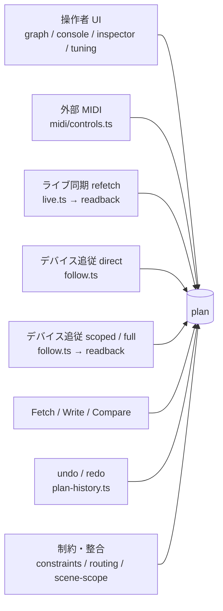

# ライブ同期レース診断ハーネス

> English version: [../en/live-race-harness.md](../en/live-race-harness.md)

ライブ同期中に、操作者の編集がデバイス由来の読み戻しに追い越されたり、送信されないまま
スナップショットに飲まれたりする欠陥を、体系的に検出するための計装ハーネスの設計。

このハーネスが確かめた所見と、駆動した修正の経緯は、プロジェクトの非公開のメモに置いてある。

## 背景 — なぜ個別修正ではないのか

ライブ同期中、1 つの可変 `plan` オブジェクトに対して 8 系統が独立に書き込む。所有権も版も
「誰が最後に書いたか」の記録も無い。



このうち refetch・追従・Fetch の 3 系統は、**読み始めた時刻と書き込む時刻が数百ミリ秒から
数秒離れる**。`readback.ts` はノードごと丸ごと代入するため、読みの途中で入った操作者の編集は
黙って上書きされる。上書きの後にスナップショットが採り直されると、その編集は差分ですら
なくなり、デバイスへ届かないまま消える。

同じ形は EQ 1-knob に限らず、COMP 1-knob、`compEqType`、insert FX セレクタ、MIDI pickup、
`captureSnapshot` の全呼び出しに等しく成立しうる。個別に潰すと 1 件ごとに実機セッションが要り、
直したことの証明も残らない。

## 段取り

| 段 | 内容 |
| --- | --- |
| 1 | トレース Bus + フロントのタップ + contract テスト + `ci.yml` の drop guard |
| 2 | オフライン解析器 + 不変条件 |
| T-1 | 疑似デバイスと、その自己適合ケース |
| 4 | 台本ジェスチャ駆動 + CI ジョブ |
| 5 | 実機較正と、解析器が出した違反ごとの修正 |

T-1 を飛ばすと T0 の床が意味を持たない。疑似デバイスが指定通りの遅延・notify・拒否を出せて
いるかを、疑似デバイス自身のログで先に確認する。

**段 3 (Rust 側タイムスタンプと `performance.now()` / `Instant` の時計較正) は取り下げた。**
このハーネスの経路に Rust は 1 行も入らない — 疑似デバイスは `window.__TAURI_INTERNALS__` ごと
差し替えるので、`ParamUpdate` / `MeterUpdate` に時刻を載せてもどのケースからも到達できず、読む側も
存在しない。加えて `ParamUpdate` は `PartialEq` を導出して `BULK_CHANGE` との比較に使っており、
時刻フィールドは等価性の意味を壊す。実機の往復のどこで時間を使っているかという問いは、経過時間を
既に計測している self-test / Compare 側の診断機能に属する。**計装は測る対象があって初めて意味を持つ**
ので、この段は「あとで」ではなく無しにする。

## 確定した方針

- **観測性**: `VITE_TRACE=1` の専用ビルド（`VITE_DEMO` と同じビルドフラグ方式）で probe を含む
  production 形状バンドルを作り、計装ティアだけそれを配信する。既存の production 配信 E2E は
  無改変で、通常ビルドに probe は入らないため `ci.yml` の drop guard はそのまま効く
- **Tauri event plugin を疑似デバイスに実装する**（`transformCallback` + `plugin:event|listen`）。
  無いと `dropzone.ts` が DOM ハンドラを登録せず `tauri://drag-drop` も届かないため、ドラッグ &
  ドロップが両方向から到達不能になり、`menu://edit` も発火しない
- **時計制御はバリア方式が基本**。疑似デバイスが特定の `vd_get` / `vd_set` を Promise で止め、
  テストが解放した瞬間にページ内からジェスチャを撃つ。窓の境界が判定になるケースはこれ以外に
  弁護できない。IPC に紐付かない 50 ms 以下の窓だけ `page.clock` を明示ステップで併用する
- **WebKit プロジェクトを 3 ケース限定で追加**。前例は `scripts/meter-bench-run.mjs`
- **機種軸は URX44V と URX22 の 2 機種**

## 変える軸

| 軸 | 値 |
| --- | --- |
| ジェスチャ形状 | 単発クリック / 連続ドラッグ / キーオートリピート / ホイール連打 / テキスト入力 / モーダル開閉 / 合成 pointerdown（pointerup 無し） / 多段フロー |
| 編集の投入位相 | 0-40 ms / 41-119 ms / 120-170 ms / 171-299 ms / 300±20 ms / 301-899 ms / 900 ms 以降 / 45-55 ms |
| デバイス遅延 | 0 / 25 / 100 / 250 ms、派生してノード読み 0.9-2 秒・全体読み 6-27 秒 |
| notify 挙動 | 無言 / echo のみ / echo と実変化 / 実変化のみ / 集中度しきい値超のバースト / BULK_CHANGE / 未登録アドレス |
| 第 2 の操作者 | 無し / MIDI absolute / MIDI pickup / MIDI トグルとフィードバック / 実機パネル掃引 / undo / ファイルフロー |
| 失敗注入 | 無し / 書込拒否 / 応答コード 400 / 読込拒否 / 受理して無視 / リンク切断 / device-lost ラッチ / メーター失敗 |
| 書込アドレス集合の形 | 形状不変 / バンク入替 / 集合縮小 / エンジン再束縛 / ワイヤ依存 / 解決不能な穴 / scene スコープ / 文字列経路 / planExternal |
| 画面状態 | GRAPH / CONSOLE / CONSOLE 非表示 / チューニング画面 / 他モーダル / テキストフォーカス / MIDI パネル |
| undo 項目の状態 | 未開 / 境界を持たない項目が開いている / 押下中 / ドラッグ中 / テキストフォーカス中 / 適用中 |
| 機種 | URX44V / URX22 |

投入位相の各値は、次の実定数の縁に置いてある。

| 定数 | 値 | 位置 |
| --- | --- | --- |
| `DEBOUNCE_MS` | 120 ms | `src/core/control/live.ts` |
| `RECONCILE_DEBOUNCE_MS` | 300 ms | `src/core/control/follow.ts` |
| `IDLE_FULL_MS` | 900 ms | `src/core/control/follow.ts` |
| `MAX_CONCENTRATION` | 3 | `src/core/control/follow.ts` |
| `REFLECT_MIN_MS` | 50 ms | `src/main.ts` |
| `IDLE_COMMIT_MS` | 300 ms | `src/ui/history.ts` |
| `RECENT_MS` | 300 ms | `src/core/midi/engine.ts` |
| `ECHO_MS` | 50 ms | `src/core/midi/engine.ts` |

### 定数の読み方で誤りやすい 3 点

- `armSettle()` と `armIdle()` は両方張られ、settle 側の照合は idle タイマーを解除しない。
  echo でない notify 1 発ごとに、300 ms 後の scoped または強制照合と、900 ms 後の**全体**照合が
  必ず両方走る。「scoped だけで済む」経路は存在しない
- `REFLECT_MIN_MS` は 50 ms の合流遅延ではなく先頭縁レートリミット。直前 50 ms に反映が
  無ければ待ちは 0
- `isEcho` は、このセッションがそのアドレスで直近 300 ms 以内に ack を受けた値 (保留キュー。長さは
  `SETTLE_TIMEOUT_MS`)、そのアドレスで飛行中の書込が運んでいる値、スナップショットが持つ値のいずれかを
  運ぶ notify を echo とみなす。フラッシュはキューとスナップショットを ack の**後**に書くので、自分の ack
  より先に届いた echo は飛行中の値だけで見分け、その ack は既に届いた告知をキューに積まない。どちらで一致しても、
  そのアドレスでそれより前にキューに積まれた書込も一緒に退ける — 飛行中の値との一致ならキュー全体を、キューとの
  一致ならその値を運ぶ最も新しいエントリとそれより古い全エントリを。これにより、実機がドラッグの最後の書込だけを
  告知したとき、窓の中で実機が前の値のどれかへ戻した操作も追従する。実機が各書込を順に遅れて告知したときは、
  最初の告知より後のものを実機自身の操作として読み、プランは最後の告知まで追従する。書込の飛行中に
  それ以外の値を運ぶ notify は追い越された notify として扱い (`hasUnannouncedWrite`)、何も適用せず、
  書込が告知された後にノードを読み直す — それでもアイドル網は実機全体を掃引する

## 不変条件

解析器が機械判定する。違反ごとに該当レコード対を出す。

| 番号 | 名称 | 内容 |
| --- | --- | --- |
| 1 | 追い越し | デバイス由来の書込で、その読みの開始が同一キーへの UI 書込より前 |
| 2 | 取りこぼし | UI 書込に対応する書込コマンドが、次のスナップショット採取までに 1 件も出ていない |
| 3 | スナップショット汚染 | 採取時点で、送信済みでない値がスナップショットに入った (節 A)。または、そのアドレスへ最後に送った値とエントリが矛盾する (節 B「値の形」・オプトイン) |
| 4 | 区間重複 | flush / refetch / scoped 照合 / 全体照合 / Fetch / Write のうち 2 つ以上が時間的に交差 |
| 5 | echo 誤判定 | 直前に同値で書いたアドレスの notify を非 echo と判定した、またはその逆 |
| 6 | 刺激の到達性 | ケースが押した notify をブリッジが拒否した = アプリは何も見ていない (節 A)。プランが発行しているのにそのセッションが登録していないアドレス = デバイス側変更が配達不能 (節 B「育った窓」)。その背後に旧「登録遅れ」検査をハーネス自己点検として残す (節 C) |
| 7 | 反映遅延 | プラン書込から実描画までがフレーム予算を超過 |
| 8 | 送信順序 | 送信列が翻訳の意図順（セレクタが配列より前）を守っているか |
| 9 | ジェスチャ‑項目整合 | 1 操作ジェスチャが正確に 1 undo 項目、または証明可能に 0 |
| 10 | 切り離された対象への書込 | DOM 対象が置換された、またはポインタ捕捉を失ったハンドラからの書込 |
| 11 | メーター購読の排他 | 生きた登録は常に 1 つ。自分が持たないストリームを解除しない |
| 12 | アドレス集合の一致 | 発行コマンド集合とスナップショットのキー集合が一致 |
| 13 | 著作者帰属 | 台帳の全書込が正確に 1 人の書き手に解決する |
| 14 | 孤児プランへの書込 | `main.ts` がもう参照していない `Plan` への書込 |
| 15 | 拒否の完全性 | 拒否は状態を消費せず、条件解消後の同一再試行が 1 回で通る |
| 16 | 終了後の静止 | セッション終了またはプラン差し替えの後に、書込・IPC・タイマーコールバックが無い |

3 も 2 節構成で、後者は**オプトイン**である。節 A は従来のもの — 走行中に一度も送っていない値がスナップ
ショットに入っており、次の差分が実機に渡したことのない値を基準に測ってしまう。節 B は**値の形**で、その
アドレスは送っているのにエントリが別の値を持つ。書込後の読み staleness が作るのはこの形である: フラッシュが
X を書き、staleness 窓の中の読みが書く前の値を返し、その後の `capture` が、同じフラッシュがそこへ書いた
エントリの上にその値を載せる。次の差分の盲点になるだけでなく、X に対する実機自身の notify は X が保留キューに
残っている間 (ack から 300 ms、`live.ts` の `isEcho`) だけ echo であり、それより後に届けば他人の変更になって、
誰も頼んでいない scoped リコンサイルとアイドルスイープの費用が付く。節 B はケースが `deviceState` (`snapshot` と同一瞬間に読んだ `memOf`) を渡したときだけ
走る。無いと偽陽性の量産機になる免責が 2 つ要るためである: **アプリ自身が走行中に送った**値は、自分の書込が
別の順で戻ってきたものであり、**実機が保持している**値は丸め込みのケースである — `capture()` はあらゆる
実機読み出しからスナップショットのエントリを動かすので、「最後の送信と食い違う」だけでは何も証明しない。
既存ケースはどれも渡していないので、判定が変わったケースは無い。

13 には、競合ではなく**受け渡し**であるキーが 1 つある。FX チャンネルの `fxEffect` である。ライブ
セッション中に EFFECT TYPE を変えると、出ていくエフェクトを先に実機から読み、その後でタイプを書く
(`live.ts`・flush が自分の先頭書込の手前で取る park)。したがって実機がプランの知らない値を持っていた場合、1 つのジェスチャの
中でそのキーに `follow-scoped` の書込と `ui` の書込が並ぶ ── これはまさにこの不変条件が報告する対の形
である。順序こそがこのジェスチャの目的で、デバイス側が先に走るのは構造上決まっている。渡された値を
そのまま返す疑似デバイスではそこに何も書かれないので、`t2d-shape-change` が見る書き手は `ui` の 1 つ
だけになる。デバイス側の値を植えてからタイプを変えるケースなら両方が見える。**あらゆる収束が同じ読みを
スコープの残りに対して取る** (`live.ts` の `parkSilent`) ので、この受け渡しはジェスチャが名指ししたノードに
限らずフラッシュが覆うどのノードにも現れうる。そこでもデバイス側が先で、先頭自身のノードは外れる ──
収束が復元するために存在するノードだからである。

6 は当初「毎フラッシュで一致するか」を検証する条件だった。このハーネスのほとんどの期間それは成立
しておらず ── 追従の登録は `begin()` と照合完了後にしか更新されなかったので、アプリ側の構造編集は
登録を古いまま残した ── **設計通りの挙動**として扱われていた。SSMCS モード変更が自分のプリセット
書込への返事を聞けないと分かって、その扱いが終わった。集合を動かしたフラッシュは自分の末尾で登録し
直すようになり、当初の言い方が再び成立する ── 依頼位置は**フラッシュの末尾**で、内側では行わない
(`live.ts` が `followSetStale` を消費するのは flush の末尾、順序の固定は `live.test.ts` の
"does not re-register before the refetch it shares a flush with")。書込はいまも、同じフラッシュの
中でそれを覆う購読より先に出る。疑似デバイスがブリッジの登録集合
フィルタを持って以降、この条件は 3 節構成である。番号は表・解析器・参照している全ケースを揃えた
まま保つため据え置く。

- **節 A ── 刺激の到達性**。`registrationWindow` 内の `notify-drop`。ケースが押した notify を
  ブリッジが拒否した = それが引き起こすはずだったものはアプリに届いておらず、それに乗った不在判定は
  無条件に通る。この不変条件の実働主題はこちらで、**ケースが何も測っていないとき**にちょうど発火する。
  ただし**拒否そのものが主題**のケース (microSD Track Count、CH → FX タップ、scene スコープが落とす
  アドレス、SETUP > GENERAL) は該当アドレスを `expectedDrops` に列挙し、節 A はそれを差し引く。
  さもないとケース自身の判定が所見として印字され、ブリッジのフィルタが作ったまさにその一群で
  「clean」が clean を意味しなくなる。節 B・C と違い `registration` を持たずに判定する ── 落ちた
  notify が届いていないことはケースが登録を捕捉したかどうかと無関係であり、登録の有無で門を作ると
  登録を捕捉しないケース全部でこの検査が黙って失われる。
- **節 C ── 登録遅れ**。登録スナップショットの外にある**配達済み** notify (センチネルは除外)。
  フィルタ導入後、これはもうアプリについての観測になり得ない ── 到達経路は `BULK_CHANGE` センチネル
  (アドレスを持たないので除外) か、間違った瞬間を指す `registrationWindow` しかない。ケースが与えた
  窓に対する**ハーネス自己点検**として残す。

- **節 B ── 育った窓**。`emitted ∖ registered` = アプリが現に書いているのに、デバイス側変更を
  ブリッジが落とすアドレス。`capture()` が集合を動かしたフラッシュは自分の末尾で登録し直すので、
  clean は「集合を動かしたジェスチャの中で登録が追いついた」を意味する。`subscribe()` が `begin()` と
  照合完了後にしか再登録しなかった頃は、構造を変える編集が何かが照合するまで窓を開けたままにし、
  この節がそれを報告していた。clean 側の表明の隣に**発火対照**を置くケースが 2 つある
  (`t2` の 1-knob OFF フラッシュ、`t2d` の FX スロット族): 同じスナップショットを 1 フラッシュ前の
  登録と組んで渡す ── アプリが以前残していた古い組そのもの ── ので、「clean」が「もう発火できなく
  なった節」であることはない。発行集合は書込からではなく
  **ライブスナップショットのキー集合** (spec の `snapshot`・trace probe 由来) として読む: 書込ベースの形は
  不変条件 12 が既に計算しているうえ、**状態**の読み取りとしては両方向に誤る ── 窓が開いたままでも
  grow フラッシュが窓から出れば沈黙し、後の `capture()` が閉じた窓を報告し続ける。同一瞬間の 2 つの
  読みに対する状態述語なので `registrationWindow` は適用されず、`snapshot` を `registration` と
  対で渡す必要がある。

節 B の clean は「発行集合が登録集合に収まっている」を意味**しない**。次のものは見えない: `planToCommands`
には既に居るがまだフラッシュされていないアドレス (不変条件 2 の主題)、既に閉じた窓、文字列パス
(`vd_set_str` = CH 名・Sweet Spot Data。スナップショットにも登録にもエントリを持たない)、`planExternal`
param、セッションが無い状態。逆向きの差は意図的に判定しない: `FOLLOW_USB` (レートの Follow USB のスイッチ)・LCD 選択・HOME の [Sends] の Send 先 (実験的起動のときだけ)・[CUE] のフラグは手で登録に
足されておりどのスナップショットにも無いが、これは無害な向きである。

`vd_params_subscribe` の `addrs` 引数がそのまま登録集合なので、以上はすべて機械的に採れる。

この 3 節は番号を共有していても問いの種類が違うので、所見 (`Finding`) はすべて **`class`** を持つ ──
`product` (アプリが誤動作した) / `case` (ケースが何も測っていない可能性がある) / `harness`
(ハーネスが自己矛盾した) ── で、`report()` は不変条件番号より先に class で束ねる。既定は `product`。
別の class を出すのは 2 つで、条件 6 の内訳は節 A が `case`、節 B が `product`、節 C が `harness`、
条件 16 はトレースに無い quiesce の印を `harness` として報告する。
読み手が答えるべき問いが群ごとに違う ── アプリを直すのか、ケースを直すのか、ハーネスを直すのか。

## ティアとケース

各ティアは前のティアが緑でなければ解釈できない。T0 が赤いまま T1 が赤いのは、アプリではなく
ハーネスのバグ。

ケースごとの手順・疑似デバイス設定・判定は `e2e/race/t*.spec.ts` の各ファイルが唯一の真実として持つ。
この表は何を測るケースなのかを述べる。

### T0 baseline — 床と到達性

| id | 対象 | 何を測るか |
| --- | --- | --- |
| `baseline-fake-answer-timing` | ハーネス | 疑似デバイスがどのコマンドにも送った側より後のタスクで、問われた順に応答すること。ワーカー上で止めた読みがワーカー外の応答を止めないこと (契約の項 s) |
| `baseline-quiescent-floor` | 全体 | 無操作のライブセッションが書込も読み戻しも生まないこと。全ケースの判定はこの痕跡との差分 |
| `baseline-single-edit-latency-ladder` | console | 単一編集を 4 遅延で。以降の全位相が測られる基準線と、遅れのどこまでが回線かの較正 |
| `baseline-graph-surface-sweep` | graph | GRAPH の全ジェスチャが駆動語彙で撃てること。書かないはずのジェスチャが本当に書かないことの否定側判定 |
| `baseline-console-surface-sweep` | console | CONSOLE の全操作。フェーダーの可動域が複数箇所で別々に書かれている件を既知オフセットで連続実行し、メインフェーダー押下の両方 (つまみ上 = 掴むだけで書かない / 溝上 = つまみがポインタへジャンプ) を含む |
| `baseline-inspector-surface-sweep` | inspector | 全ノード種の全制御。「トグルは再描画、スライダーはしない」規則を制御ごとに固定 |
| `baseline-tuning-surface-sweep` | tuning | GATE / COMP / EQ 画面。閉じ方 3 通りと fine グリッドの適用範囲 |
| `baseline-shell-flows-sweep` | 混合 | 同意ゲート・ライセンス・読込報告・レート選択・更新確認・投入・最近使用・環境設定の全行 |
| `baseline-view-locale-churn` | 混合 | ジェスチャ中に全再構築を起こす唯一のデバイス非依存の経路 (言語・テーマ・ビュー切替) |

### T1 overtake — 追い越しと取りこぼしの本体

| id | 対象 | 何を測るか |
| --- | --- | --- |
| `overtake-scoped-readback-vs-edit-ladder` | console | scoped 読みが編集を追い越す最小形。読み窓に沿って位相を振る |
| `overtake-full-reconcile-vs-edit-ladder` | 混合 | 数秒の全体照合が編集・undo・プラン差し替えを受け付けてしまうか |
| `overtake-edit-during-flush-send-loop` | console | 送信ループ内の 2 度目以降の編集。単一の保留枠が複数編集を畳むか |
| `overtake-edit-during-converge-await` | inspector | 凍結コピー経路の対照。ここが赤ければコピーが失われている |
| `overtake-edit-during-refetch-await` | tuning | 生プランを採るスナップショットに編集が飲まれる。対照との差が欠陥の所在 |
| `overtake-converge-and-refetch-one-flush` | 混合 | 2 つの修復が 1 フラッシュに乗り、弱い方が後に走る |
| `overtake-converge-latch-starvation` | console | 送信が枯れる方向の欠陥。連続編集中にデバイスへ何も届かなくなるか |
| `overtake-notify-echo-vs-genuine-during-flush` | console | 位相とアドレスを固定し、真の echo かどうかだけを変える |
| `overtake-direct-notify-ahead-of-the-send-loop` | console | 凍結されたコマンド列がまだ到達していないアドレスへのデバイス側変化 |
| `overtake-foreign-notify-inside-our-write` | console | 自分の書込が送信中のアドレスに、その告知より前に届くデバイス側の値。窓の中の 2 つ目の編集の有無と、ノードの読み直しの期限が書込の ACK と告知の間に来る形で分ける |
| `overtake-foreign-notify-with-an-edit-on-the-strip` | console | 同じ上書きされる値に、ノードの別のコントロールへのまだ送っていない編集が重なる形。追従の settle を越えて書込を止める・すぐ解放する・ノード上の実機側の変更と並べる・flush の窓の中で編集する、で分ける |
| `overtake-edit-in-the-flush-window-vs-follow-read` | console | 通常の実機側の変更がノードを読み直す期限に、まだ flush の窓の中にある編集 |
| `overtake-reconcile-during-reconcile` | 混合 | 照合自体の再入。操作者を入れずに測る |
| `overtake-direct-scoped-coalesce-boundary` | console | 反映合流窓の縁で、直接反映が全体反映へ格上げされるか |
| `overtake-drag-flush-backpressure` | console | 現実的なドラッグと現実的な回線。操作者が体感する収束時間 |
| `overtake-refetch-reads-before-the-write-settles` | tuning | 疑似デバイスに状態が無かった唯一の窓 = 受理済みでまだ報告できない書込。`t1c-refetch-stale.spec.ts` |
| `overtake-held-repaint-vs-the-next-gesture` | inspector | select がフォーカスを持つあいだインスペクタが保留した実機側の変更を、操作者の次の click・Tab・タップが解く: そのジェスチャーが届くか — 書込が出るか、フォーカスが再構築後のコントロールに残るか。`t1e-held-repaint.spec.ts` |
| `overtake-side-link-echo-vs-panel-selection` | console | プランの外で実機の LCD 選択とつながる、ステレオのチャンネルが表示する側: ライブ開始が選択中のチャンネルの側を取るか、告知の遅れの内に 2 回切り替えても操作者が置いた側で終わるか、実機での選択がその側を表示して何も編集しないか、セッション後の切り替えが何も書かないか。`t1f-side-link.spec.ts` |

### T2 shape-change — 書込アドレス集合の形を変える param

| id | 対象 | 何を測るか |
| --- | --- | --- |
| `shape-comp-eq-type-bank-swap` | inspector | アドレスの同一性と値の極性が同時に変わる唯一の param |
| `shape-eq-oneknob-registration-blindspot` | tuning | 再計算を起こした当のブール値が、再計算の通知先を登録ごと集合から外す自己盲目。告知は配達されて置けないのではなく拒否される。節 B の発火対照も持つ |
| `shape-eq-oneknob-level-refetch-storm` | tuning | ドラッグ中に毎フラッシュ読み戻しが走り、履歴が再基準化され続ける |
| `shape-insert-fx-select-ordering` | inspector | 値ではなく 1 フラッシュ内の 3 グループの順序 — セレクタ → それが埋め直すエンジン配列 → バイパス — が正しさを決める。実機が選択のたびに配列を既定で埋め直し、バイパスを自分で入れるため |
| `shape-insert-fx-engine-array-collision` | inspector | 2 つのプラン所有者が 1 つのデバイスアドレスを共有する構造的衝突 |
| `shape-fx-effect-type-slot-family` | inspector | param id ではなくスロット集合が変わる。undo が構造上不完全になる |
| `shape-signal-type-pair-link` | inspector | 書込が別ノード全体をデバイス側でリセットする唯一の param |
| `shape-pan-bal-mode-switch` | inspector | デバイスが他の接続の値を書き換える。undo 自体が古い書込になる |
| `shape-bus-type-and-pan-link-locks` | 混合 | ノード A への書込が、書かずにノード B・C の観測状態を変える。BUS Type の書込そのものが一緒に運ぶのは、その MIX の send バンクを本体と同じリセット値にしたものだけ。Pan Link 中の send のパンの編集は Send 元自身のパンを動かし、send のパンは書かない |
| `shape-pan-link-send-pans` | 混合 | 実機が告知しない書き換え: Pan Link の間はその MIX への send のパンを書かないので、チャンネルの PAN を動かした後の収束に振れる値が無く、計画の send のパンはその動きに追従する (send のパンの MIDI コントロールがチャンネルの値を返す)。実機側でもアプリのパネルでも、切ると計画の send のパンがチャンネルのパンになり、次の書込はその値しか送らない。アプリのパネルで FIXED にすると実機の Pan Link は切れ、計画の Pan Link も切になるので、入れ直す書込は無い |
| `shape-sdrec-track-count-readonly` | 混合 | アプリが読むだけで書かない param。中断原則の否定対照。デバイス側変更は届かない |
| `shape-sample-rate-and-follow-usb` | 混合 | 常に書込集合の先頭にあり、デバイスが自力で戻せる唯一のスカラー |
| `shape-scene-write-scope` | 混合 | 非プランの設定が、書込差分・スナップショット・登録を一斉に作り替え、落としたアドレスへの追従を盲目にする |
| `shape-routing-wire-selectors` | graph | 意図的な NONE 番兵と、偶発的な穴（何も言わない）を並べる |
| `shape-send-emission-wire-presence` | console | 最も日常的な操作が、モード切替に見えない形で集合の形を変える。読み取り専用の FX タップは追従不能 |
| `shape-refused-and-acked-writes` | 混合 | 3 つの拒否形と、閉じない差分がフラッシュループを作らないか |
| `shape-string-path-writes` | 混合 | 差分機構を完全に迂回する書込。無害な例と重大な例を並置。デバイス側リネームは配達されるようになり、Sweet Spot Data のプリセット書込も配達され、refetch が直す |
| `shape-device-setup-plan-external` | 混合 | 一度も発行・読戻・登録されない = 配達されない param 群と、唯一の傍受フック |
| `shape-insert-fx-rate-and-slot-availability` | inspector | 発行の門ではなくデータとして表現された制約と、ノード間の取り合い |

### T3 undo — 境界・和音・拒否・再基準化・リセット

| id | 対象 | 何を測るか |
| --- | --- | --- |
| `undo-pointer-boundary-ladder` | console | 遅延確定・保留の着地・ドラッグ畳みの 3 規則をマクロタスクの縁で |
| `undo-drag-latch-and-orphan-press` | 混合 | pointerup を伴わない合成のマウス pointerdown と、それが残した押下をボタン無しのホイールが終わらせること |
| `undo-keyup-autorepeat-boundary` | console | ステップキーは境界、文字キーは境界でない、の 2 規則を同一走行で |
| `undo-focusout-text-boundary` | graph | 待機間隔を意図的に超えても確定させたくない唯一の形 |
| `undo-idle-backstop-wheel-ladder` | inspector | DOM 境界を持たないジェスチャを、それを定義する定数の縁で |
| `undo-window-blur-mid-drag` | console | ポインタイベント無しでジェスチャが終わる唯一の経路 |
| `undo-diff-at-commit-post-mutations` | inspector | 漏斗自身が `markChanged` の後に行う 4 か所の追加変更 |
| `undo-empty-diff-and-redo-stack` | graph | スタック自身の算術（空差分・redo 無効化・上限退避）と遷移時のみの深さ報告 |
| `undo-chord-ownership-matrix` | history | 7 つのフォーカス対象 × 8 つの和音形。誰が打鍵を所有するかの網羅表 |
| `undo-refusal-ladder` | history | 拒否の順序と、拒否が項目を消費しないこと。許容側も含む |
| `undo-apply-sequence-hidden-and-viewport` | graph | 適用の順序そのものと、undo の書込がデバイスへ届くこと |
| `undo-during-device-activity-ladder` | history | 5 つのデバイス動作 × 5 つの位相。門が経路ごとかリンクごとかを表にする |
| `undo-entry-survives-device-sweep` | history | 実機を触っている間のアプリ編集が 1 エントリとして残り、その下の既存エントリも残ること |
| `undo-reset-paths-and-pending-commit` | history | 7 つのリセット経路と、リセットを生き延びる 2 つの競合 |
| `undo-macos-edit-menu-path` | history | 唯一のネイティブ面。和音と拒否順序が異なる唯一の経路 |

### T4 midi — 門を持たない第 2 の操作者

| id | 対象 | 何を測るか |
| --- | --- | --- |
| `midi-vs-main-fader-absolute` | midi | MIDI の反映が、捕捉中のポインタの下でストリップを差し替える |
| `midi-vs-send-fader-relative-baseline` | midi | 相対ドラッグは MIDI 書込を上書きではなく算術で消す |
| `midi-pickup-without-output-port` | midi | 出力ポートが開いていなくても、盤面値が動けば pickup が解除される |
| `midi-toggle-echo-window-ladder` | midi | 1 発限りの防御が、本物の押下とループバックを区別できない |
| `midi-continuous-echo-reaches-the-unit` | midi | 同じ防御をフェーダーで。防御が無いとエコーがそのまま実機書込になる |
| `midi-gang-fanout-and-head-reelection` | midi | 1 対多の書き手と、無関係な編集が所有権を移す |
| `midi-learn-arm-during-rerender` | midi | 第 2 操作者の**設定**がデバイスと競合する唯一のケース |
| `midi-write-during-refetch-snapshot` | midi | 門を持たない書き手と、スナップショット再基準化の組み合わせ |
| `midi-edit-enters-history-ladder` | midi | 開いている undo エントリの内外での MIDI 編集: エントリに合流するか自分のエントリを開き、どちらでも元に戻せる |
| `midi-14bit-pair-and-cross-binding` | midi | 値の方針ではなくメッセージの復号。永久に発火しない割当も作れる |
| `midi-bal-mirror-clobbers-partner` | midi | 鏡映を介した衝突 — アプリ側 2 者間のものと、値を動かさない鏡映の書き込みと相方を別の値で報告した読み出しとの間のもの |

### T5 drop — 失敗注入

| id | 対象 | 何を測るか |
| --- | --- | --- |
| `drop-link-loss-mid-flush-ladder` | 混合 | セッション終了宣言の後に何件の書込が漏れ出るか |
| `drop-link-loss-mid-reconcile` | 混合 | 半分だけ読めたプランが権威として反映され、履歴がそれに対してリセットされる |
| `drop-write-reject-mid-send` | 混合 | 再試行が新鮮な差分から組まれ、順序が中断を生き延びるか |
| `drop-read-reject-mid-fetch` | 混合 | 生きた書き手が前任のプランに繋がったままになる唯一の経路 |
| `drop-device-lost-latch` | 混合 | リンクイベントとして来ない唯一の切断形。消耗による失敗 |
| `drop-bulk-change-sentinel-mid-drag` | console | 最大のデバイス側事象が、最小のアプリ状態（押下中のポインタ）に落ちる |
| `drop-unknown-address-notify-storm` | 混合 | 3 本立て: ノードに置けない (`SAMPLE_RATE`) / ノードに置ける / 未登録 (拒否) |
| `drop-missed-notify-idle-net` | console | デバイスが何も言わない場合。安全網の起動条件が守る対象と同じか |
| `drop-concentration-threshold` | 混合 | 追従層で唯一の整数しきい値をまたぐ |

### T6 teardown — セッションとプランの生存期間

| id | 対象 | 何を測るか |
| --- | --- | --- |
| `teardown-plan-replacement-during-reconcile` | 混合 | Fetch を守る門が、追従が始めた同一の読みを守っていない |
| `teardown-model-switch-during-flush` | 混合 | アドレス語彙そのものが実行中の操作の下で変わる |
| `teardown-live-toggle-race` | 混合 | セッション生存期間そのもの。世代印が反証可能になる唯一の場所 |
| `teardown-deactivate-with-armed-timers` | 混合 | モジュール水準のラッチがセッション毎に閉じているか |
| `teardown-dyn-screen-close-during-refresh` | tuning | ドラッグ保護のための遅延機構自体が危険になる |
| `teardown-flow-refusals` | 混合 | 守られた読みと守られていない読みを同じフロー (File > New・File > Open) で対比。機種切替は守られた側だけ — ピッカーを固めるライブセッションが無いのはそちらだけ |

### T7 meter — プロセスに 1 つの購読

| id | 対象 | 何を測るか |
| --- | --- | --- |
| `meter-slot-handover` | 混合 | 受け渡しの基準線。以下 2 件はこれとの差分 |
| `meter-late-unsub-kills-console` | 混合 | 閉じた画面の遅れた解除が、コンソールの新しいストリームを落とす |
| `meter-rescope-inside-subpending-ladder` | console | 登録待ちの中に届いた再スコープが丸ごと落ちる |
| `meter-tap-change-resubscribe` | console | 1 ストリップの変更で全ストリップが黙る。機種別表の解決も |
| `meter-feed-paint-vs-follow-churn` | console | 正しさではなく費用を測る唯一のケース |
| `meter-error-ends-session` | 混合 | 報告された失敗と沈黙した失敗の差 |

### T8 stress — 収束・ファズ・ジッタ・リーク

| id | 対象 | 何を測るか |
| --- | --- | --- |
| `stress-three-operators-one-node` | 混合 | 操作者・MIDI・実機パネルが 1 チャンネルを同時に駆動して収束するか |
| `stress-seeded-schedule-fuzz` | 混合 | 誰も仮説を立てなかった 3 者同時の交錯。種で決定的に再現できること |
| `stress-latency-jitter-storm` | console | ジッタは応答の到着時刻を散らす。固定遅延との対比で「散らばり」と「キュー深度」を分ける |
| `stress-long-session-quiescence` | 混合 | 操作が生む状態ではなく、操作を生き延びる状態 |

### 差分設計

多くのケースが同一ジェスチャの位相梯子、または 1 変数だけを変えた対で構成されている。
**梯子でないケースの検出は「所見」であって「発見」ではない**という運用にする。

主な対は、converge 待ちと refetch 待ち、scene スコープと全スコープ、実機掃引の有無、
MIDI 出力ポートの開閉、churn の有無、ジッタの有無、登録済みと未登録の notify、
CONSOLE の表示と非表示、守られた Fetch と守られていない照合。

## 疑似デバイスの契約

現行の E2E スタブは各コマンドに後続のタスクで、それ自身の遅延なしに応答するため、本書のどの窓も存在しない。
疑似デバイスは次を満たす必要がある。

| 記号 | 要件 |
| --- | --- |
| a | param id ごとに設定できる遅延と、任意のジッタ |
| b | 実状態マップ。読み戻しは書かれた値を返す — `staleAfterWrite` (項 n) が台本を書かない限り即座に。加えて「書かれた値と無関係に X を返す」乖離フック |
| c | notify スケジューラ。echo・実変化・未登録アドレス・BULK_CHANGE・沈黙を、受理した書込に対する相対時刻で発行 |
| d | 拒否注入。コマンド番号と param id で、伝送拒否・応答コード 400・受理して無視を撃ち分ける |
| e | device-lost ラッチ（以後すべてのコマンドが同一理由で失敗） |
| f | リンク切断イベントの任意発火 |
| g | メーターと param の各チャンネル。購読遅延を独立制御し、購読・解除のカウンタを持つ |
| h | 接続ごとに増える世代印と、それを尊重する切断 |
| i | MIDI ブリッジ。入力バーストの台本と、出力バイトのログ |
| j | `menu://edit` の発行と、メニュー状態・ラベル送信のカウンタ |
| k | `transformCallback` と `plugin:event|listen` |
| l | ブリッジの notify フィルタ。param notify を渡すのは購読が張られている間かつそのセッションが登録したアドレスのみ、加えて `BULK_CHANGE` センチネル ── `Subs::absorb` を写し、バッチ内のエントリ単位で判定する |
| m | 同じフィルタのメーター側。読み値を渡すのはメーターチャンネルが張られている間かつそのセッションが登録した `(meter_id, x)` のみ。読み値は必ずアドレスを持つのでセンチネルは無い |
| n | 書込後の読み staleness。`staleAfterWrite[addr] = n` で、そのアドレスへの**各**書込の後 n 回の読みが、その書込の**前**に持っていた値を返す。`mem` は真値のまま = 実機は書込を**受理**しており、まだ報告できないだけである。数値経路のみ。窓を**終わらせる**のはこの設定の役目ではない: 値を変える書込は必ず告知され (下記)、その告知は台本の読み回数が残っていようと窓を閉じる |
| o | その告知そのもの。ケースがアームする必要はなく無条件である: 実機が**報告する値**を変える書込は、その **ACK から** `cfg.announceMs` 後に告知される — 既定は 100 で、実機の書込の**発行**から notify までの中央値を丸めた値を、ここでは ACK から数える。沈黙は 3 通りあり、いずれも同じ規則から出る — 同値書込 (0〜1 ms で ACK され、告知されない)、`ignoreWrites` のアドレス (ACK して格納しないので報告値は動かない)、`diverge` されたアドレス (実機は元から持っている値を主張し続ける) |
| p | 同じ窓の**名前経路**版。`staleAfterWrite` は文字列アドレスにも効き、`vd_set_str` の後 n 回の読みが置き換えた前の名前を返す。URX44V の名前の窓は 81 ms = 文字列経路は例外ではなく、疑似デバイスはその生涯ずっと例外として扱っていた。**告知も項 o と同じ規則で出る。しかも両方の半分とも、数値からの類推ではなくこの経路そのものについて成り立つ** — 値を変える名前書込は ACK から `announceMs` 後に告知され、窓を閉じる (実機は自分の ACK の後、ACK から 1〜102 ms で告知し、大半は 66〜102 ms。10 ms 未満の下側の裾があり、数値側の分布には無く、原因は未同定)。同値の名前書込は何も告知しない。名前のアドレスは登録集合に入っているので (追従が実機側のリネームを運ぶようになったとき加わった) アプリはこれを受け取る。Sweet Spot Data も加わった — SSMCS のモード変更の flush がそれを購読する (`t2b-shape-change`)。`t1d-name-window` がこの窓を必要とした最初のケース |
| q | Pan Link の通知の無い書き換え。ケースが名指したグループについて (`installFake` の `panLink: [{ link, source, sends }]`): スイッチの入を書くとグループの send のパンがすべて Send 元のパンになり、入の間は Send 元を書けば send が追い、send を書けば Send 元 (と他の send) がその値になる。切を書いてもそのまま残る。どれも告知しない — 告知されるのは項 o の規則どおり書いたアドレスだけ。実機は send のパンの書込を約 2 秒後に反映するが、疑似デバイスはキュー時点で反映する。send のパンが書かれたかどうかを問うケースにとって厳しい側のモデルである。グループがその MIX の BUS Type のアドレス (`busType`) を名指したときは、そこへ FIXED を書くとスイッチが切になり、これも告知しない。VARI を書いてもそのまま。スイッチの `seedMem` は状態であり、何も書き換えない。`shape-pan-link-send-pans` がこれを必要としたケース |
| r | 状態マップの初期内容: node-param のリーフが書き込まれる全アドレスは、機種の工場出荷値を持つ — `defaultPlan` の node params を `planToCommands` で出力し、`planToCommandOrigins` がコマンドの出所として node-param のリーフを名指すものを残す。そこを読むと、誰も書いていない実機が持つ値が返り、アプリには丸めるものが無い。それ以外の、何も書いていないアドレスは 0 を返す — ルーティングのセレクタ、ワイヤの param (チャンネルのフェーダーと PAN は STEREO send のもの)、色 — ただし STREAMING のソース (左右のセレクタ) は工場出荷の STEREO から始まる。別の状態が要るケースは自分で入れる (`setMemAt`、または spec の `seedMem`) |
| s | 応答のタイミング: どの応答も、コマンドを送ったタスクより後のタスクで確定し、そのマイクロタスクの中では確定しない。通常のスタブが使うのと同じキュー (`e2e/tauri-stub.ts` の `installAnswerQueue`) を通り、先に問われたコマンドの応答が既に揃っているならそれを追い越さない。遅延・バリア・拒否・device-lost ラッチはどれも応答がキューに入る前に効き、まだ止められている応答は後から問われたものを何も止めない — ワーカー上で止めた読みはワーカー外の応答を遅らせない。`ipc-end` の記録と書込の告知のアーム (項 o の ACK) は、応答がアプリに届いた時点で行う。`baseline-fake-answer-timing` が固定する |
加えて **バリア**: `blockAt({ cmd, nth })` で特定のコマンドを止め、`release()` で解放する。

項 n・o・p は疑似デバイスがその生涯ずっと**持っていなかった**ものであり、その欠落は中立ではなかった —
疑似デバイスは書込をキュー時点で確定し、同じマップから読みに答えていたので、「ACK 済み」と「読める」の間の
状態が無く、書いた直後にアドレスを読み返すケースはすべて存在しえない実機を模していた。どの読みが stale かは**時間ではなく回数**で決まる。バリアが存在する理由と
同じで、時間で決めると全判定が CI 負荷の性質になる。staleness は両隣とは別物である — `divergeAt` は「アプリが
書いたことのない値を実機が保持し、決して一致しない」、`ignoreWrites` は「ACK だけ返して格納しない」(したがって
何もアームしない)、staleness は「少し後に一致する」であり、アプリの修復経路はすべて「もう一度読む」ことの上に
建っている。

項 o は**ノブではなく契約**であり、重要な点が 2 つある。疑似デバイスは **announce する義務を負う**: 値を変える
書込を受理しながら一切 announce しない機器は、どの URX の振る舞いとも違うので、announce を待ってから読み直す
アプリを疑似デバイス自身の矛盾で落とすことになる。そして基準は**キュー点ではなく ACK** であり、これは細部では
ない。遅いリンクの profile では、キュー点基準の告知は**アプリが自分の書込の成功を知らされる前に**届き、実機が
一度も見せていない順序になる (notify は書込発行から 9〜204 ms で、必ず ACK の後。ACK は、実機が既に持っている
値の書込なら 0〜1 ms で、値を変える書込では 2 ms・11 ms の例がある)。t8-stress は
これで赤になり、修正を入れても赤のままだった。ACK 基準に直すと通り、しかも main アームと数字が完全に一致する。
`announceMs` の**既定値**は live.ts の 120 ms フラッシュ窓より**下**に置く。通常のケースが揃って同じ 1 点を測る
のを避けるためで、これを超えると告知はドラッグの次の書込に追い越され、動いてしまったスナップショットに対して
届く。この追い越しは疑似デバイスの作り物ではなく**実機の挙動**であり (実機の ACK から notify までの 58〜151 ms は
120 を跨ぐ)、
その後に起きていたことは告知ではなく**アプリの側の欠陥**だった: エコー判定がスナップショットの 1 値との一致比較
だったため、追い越された告知が実機由来の変更として読まれ、既に置き換えられた値をプランへ書き戻し、続くアイドル
全体照合がアンドゥ項目を全件消していた。`live.ts` は ACK 済みで未告知の書込を保持するようになり、`announceMs` を
意図的に 120 超へ上げるケースは `t3-undo.spec.ts` の `late echo of an overtaken write`。

さらに告知は**前方へ合流する**。**告知が出る前に**同じアドレスへの後続の書込に追い越された書込は、告知されない。
実機は最終的に保持した値を報告し、途中で通過した値については何も言わないので、1 つのアドレスへの連続した書込には
最後の値を載せた notify が 1 本だけ返る。2 つの書込が連続として扱われるのは、後続の書込が最初の告知より先に
ワイヤへ出たときだけで、そうでなければ連続ではなく逐次の 2 書込である。疑似デバイスは保留中のタイマーを取り消すことでこれを表す。同じことの
言い換えで、**まだ発火していないタイマーは実機がまだ出していない告知**であり、既に出たものは取り消せない。
1 書込につき 1 本を出す形が、`settle.ts` に「義務のある書込ごとに告知 1 本」を要求する判定を出荷させた:
ドラッグは告知が返るより高い頻度でフラッシュするので、最後以外のすべての操作が「どこにも届かなかった書込」として
報告され、そのたびに全体掃引が張られる。ハーネスにはそれを言う手段が無かった。**分かっていないのは、
生き残った 1 本がどちらの書込を起点にするか**である。連続を保つ 2 つの書込の間隔が、告知遅延そのものの
ばらつきよりはるかに小さく、2 つの起点の分布が重なる。このばらつきは**その告知が属する書込の発行**を起点にした
遅延である。この起点をバースト起点と混ぜると、どちらでもない範囲になる。

これは上の追い越しについて明示すべきことでもある。合流が追い越しの境界を決めるからである。追い越しは
「遅れた告知」ではなく**窓**である — 追い越す側の書込の **ISSUE** (アプリのスナップショットが動く点) と
**ACK** (疑似デバイスが取り消す点) の間で、その幅は `latency.set` に、ACK がアプリに届くまでの 1 タスク
(項 s) を足したものである。既定の 0 では幅が 1 タスクしかない。したがって `late echo of an overtaken write` は
自前の set レイテンシを設定し、**最初の書込の告知が実際に出たこと、かつ 2 番目の書込の発行より後に届いた
ことを assert する**。この assert が無ければ、何も追い越されなかった走行でも通過する: 他の assert は「何も
壊れていない」を言うだけで、それは何も起きなかった走行の見た目と同じだからである。

**矯正 (coercion) は意図的に一切モデル化していない。** `diverge` は**読み**を曲げるだけで `mem` に触らないので、
実機が報告する値は動いておらず、告知すべきものが無い。主張値を告知させれば、それはアプリが一度も送っていない値を
運ぶ notify = アプリから見れば矯正ではなく**実機由来の変更**であり、既に `divergeAt` を使っている十数本の spec の
意味を黙って変えてしまう。実機が書込を矯正するのか、あるいは ACK して黙って捨てるのかは**分かっておらず** — 計装した
実機セッション 3 本では一度も現れなかった — **測定できるのかどうかも分かっていない**。したがってこれは「測れば
決まる保留」ではない。そういう機器挙動が実際に観測されたときにノブを足すのであって、その前には足さない。

**そもそもフィルタが必要な理由**。ブローカーに接続して**何も登録していない**
クライアントにも、push ストリームは丸ごと届く ── 購読を一切張っていない接続にメーターフレームと
実機の自走する時計のフィールドが届く。ブローカーは全ブロードキャストしており、そのストリームと
アプリの間に立っているのは `Subs::absorb` だけである。無条件に転送する疑似デバイスが「出荷されていない
デバイス」を測ることになるのはこのため。

(l) について: `vd_params_subscribe` は登録集合を丸ごと差し替え、`vd_params_unsubscribe` は
チャンネルを落とす (Rust 側 `param_ch = None` の効き目のある半分)。Rust の `param_addrs.clear()` に
あたる処理は**意図的に写していない**: `paramAddrs` はハーネス側の「アプリが**最後に**登録した
アドレス」という観測点で、セッション終了後に約 80 のスペック箇所が読んでいる。駆動側のヘルパは
`pushNotify` (エントリごとの判定を返す ── 配達なら `""`、拒否なら理由)、**`pushNotifyDelivered`**
(押した上で拒否されたアドレスを名指しして throw する。アプリの**応答**が主題のケースはこれを使う)、
**`pushBulkChange`** (全体照合を 1 回起こす正規の手段)、**`notifyDropsOf`** (拒否そのものが主題の
ケース向け)。

**`pushNameNotify`** はその文字列経路版 ── 実機の LCD で行われたリネームであり、本文を `value_str` に、
数値の `value` に 0 を載せる。判定の返し方は同じで、**告知の前に名前を格納する**: 格納せずに告知するのは
「自分が持っていない値を報告する実機」であり、直後の読みが自分の notify と矛盾する。名前の**書込**が生む
告知 (項 p) と発行部を共有しているので、台本のリネームと実機自身のリネームが別々の実機を記述することはない。
なお `divergeAt` の文字列版は**無い** — 在ったものは最後の呼び出し元が `pushNameNotify` へ移った時点で
削除した。誰も走らせない操作面は、何もそれを真に保たない「実機についての主張」になるからである。

どちらの購読も、疑似デバイスが他の値を確定させるのと同じ**キュー投入時点**で張られる。理由も同じで、
`vd.rs` の `ParamsSubscribe` / `MetersSubscribe` 節は登録を*送る*だけ (`reg_param` / `reg_meter` は
撃ち放しで、応答は後から `pump` が回収する) であり、ハンドラ内でソケット読み取りが起きない =
`absorb` が走り得ない。登録が飛行中に届いた notify は、したがって**後から新しい集合で判定され新しい
チャンネルへ配達される**。解決時点で張ると古い集合で判定して古いチャンネルへ配るという二重の誤りに
なり、しかも購読へのバリアや `subscribe` 遅延の台本で実際に到達できてしまう。この設置は拒否分岐と
device-lost 分岐よりも**手前**に置いてある: Rust 側の代入は登録ループの結果に関わらず実行され、失敗は
`reply` だけで返るため、拒否された購読でも購読は差し替わり、前の購読が残ることはない。

チャンネルが落ちるもう 1 つの経路が**接続の世代**である。`vd_connect` と世代印の一致する
`vd_disconnect` はどちらも teardown を走らせ、両チャンネルと両登録集合を落とす ── `Cmd::Shutdown` で
ワーカーごと `Subs` 全体が消えること (および `install()` が前のワーカーを落とすこと) の写しである。
これが無いと、疑似デバイス側の判定条件は「アプリが unsubscribe を呼んだか」となり、ブリッジ側の
「ワーカーが生きているか」とずれる ── アプリの unsubscribe は撃ち放しなので、この差は実在の窓になる。
アドレス集合 2 つは teardown を生き延びる。理由は (l) に述べたとおり。

(m) について: 同じ 3 つの形をそのまま 1 段下に置いたもの。`vd_meters_subscribe` は登録集合を丸ごと
差し替え、`vd_meters_unsubscribe` はチャンネルを落とす (Rust 側 `meter_ch = None`)。`meterAddrs` を
残すのは `paramAddrs` と同じ理由。ヘルパは `pushMeters` (フレームごとの判定を返す)、
**`pushMetersDelivered`** (拒否されたアドレスを名指しして push 地点で throw する。**読み値表示**が
主題のケースはこれを使う ── 拒否されたフレームは「再描画されなかったバー」と区別できない)、
**`meterDropsOf`**。痕跡に残すのは拒否されたフレームだけで、種別も専用の `meter-drop` にしてある:
実機のフィードは連続していて 1 読み値 1 レコードでは痕跡が埋まるうえ、種別を分けることで
param notify の到達性を判定する不変条件 6 にメーターの通信が混ざらない。これ以前はメーター側に
フィルタが無く、各スペックが自前で押す前に絞っていたため、製品のアプリが決して受け取れない
フレームが何も残さず消えていた ── (l) が param 側で潰したのと同じ欠陥の型である。

## 駆動側の規約

- 値が主題なら、合成ドラッグより focus とキーステップを優先する。最も頑健で、1 押下が 1 undo
  項目に対応する
- pointerup を伴わない合成 pointerdown は意図的に使い、押下状態への副作用を痕跡に残す。これはポインタ
  種別を持たない押下を残し、押下はそれぞれ自身のポインタの解放でしか終わらず、ボタン無しの移動とホイールが
  終わらせるのはマウスの押下だけなので、ウィンドウの `blur` まで待機時間の受け皿を封じる。ワイヤ選択には
  使わない: `e2e/graph-helpers.ts` の `selectWire` は解放も配送する
- 各ステップは**意図した位相と実際に達成した位相を両方**記録する。梯子は達成値が入って初めて
  解釈できる — そして段の配置は意図値ではなく達成値に対して決める。sleep からマークまでの
  駆動側自身のコスト (クリック、ロケータ解決) は全段に等しく加算され、しかも**一方向**である:
  ジェスチャを必ず後ろへずらすので、窓の縁の後ろに置いた段は頑健で、縁の手前に置いた段が
  遅いランナーに奪われる
- **可動域の N% を狙うジェスチャは、動きうる値を基準に狙っている。** `t0b` の
  `main fader jump-to-click` は可動域の 30%、`t3b` のダブルクリック前置は 32% を押していたが、
  どちらも目的は「フェーダーを動かすこと」だけだった。工場値 0 dB ではキャップ中心が可動域 25% にあり、
  このプロジェクトのビューポートではキャップが可動域の約 14% を占めるので、**どちらもキャップの内側**
  だった — メインフェーダーがジャンプではなくキャップを掴む形に変わった日に、両方とも無言で
  「何も書かないジェスチャ」へ化けた。既定の 800px 高ウィンドウなら外側なので、**ビューポートが
  変わるだけで意味が反転する**。狙いは対象の矩形から取ること。そしてコントロールに
  「ここを押しても書かない」側ができたら、その側を `silent: true` のジェスチャとして登録する —
  sweep の第 2 assert が両側を担うようになるのはそれによる
- **測る区間は判定を決める区間そのものでなければならず、この 2 つは取り違えやすい。** アプリ側の窓を
  張るジェスチャは、張った瞬間から測る — その次のステップからではない。`t1b` の飢餓ストリームは
  ティック 1 発目から間隔を採っていた (`at.slice(1)`) ため、`maxGap < DEBOUNCE_MS` のガードは
  「クリック→1 発目」という**判定を決める唯一の区間だけ**を覆っていなかった。余裕は 22〜30 ms で、
  CI のランナーがそれを奪った。同じ形は 1 ケースに留まらない: 繰り返しの**回数**が繰り返し間隔の
  代役になっている、`mark()` がアサーションの手前ではなくドライバ操作の手前に置かれていて操作自身の
  コストが次の段に入り込む、メッセージを配達する直前に採った位相がアプリの適用する位相の**下限**に
  しかなっていない (配達の両側で挟み、窓の内側に置く段は遠い側の端に対して判定する)。1 つの窓を共有
  しなければならないジェスチャと編集がドライバの往復で隔てられているなら、揃うことを期待せず
  **ページ内の 1 タスクで撃つ**

## 実装と実行

`e2e/race/` に実装済み。ハーネスは **独立した 2 つの Playwright プロジェクト** ── Chromium の
`race` と、`@webkit` タグ付きケース用の `race-webkit` ── で、いずれも同じ専用サーバー (ポート 4174)
から **trace ビルド**を配信して走る。通常の E2E は `chromium` プロジェクトのまま無改変・無変化。

| ファイル | 役割 |
| --- | --- |
| `fake-device.ts` | 疑似デバイス、バリア、トレース、MIDI ブリッジ、event plugin |
| `analyze.ts` | 不変条件 1 / 2 / 3 / 4 / 6 / 8 / 12 / 13 / 16 と時系列の整形 |
| `t0`〜`t8` + `t0b`〜`tzb` | ティア別のケース |
| `t2c`〜`t2f` | T2 の残り 8 ケース (書込アドレス集合の形を変える param のうち、後から埋めた分) |
| `t9-probe.spec.ts` | probe 自身の契約と、不変条件 13 / 3 — 着地した取得・ライブ同期開始の読み出しが `device-action` に帰属することを含む |

**上のティア表のケースは全件、id で対応するスペックに存在する** — 1 件を確かめるなら
`grep -rF <id> e2e/race`、全体の台帳は id そのもの。**駆動されていない**のは恒久的に skip された
サブアーム数件だけで、それぞれ理由を隣に書いてある
(固定接続なので UI から削除できない / 判定を分離できる観測点が無い / `--experimental` の launch mode を
疑似デバイスに偽らせるとアプリではなくハーネスを測ることになる、等)。**その台帳は grep ではなく
`pnpm check:skips`** — Playwright が収集した結果を読むので `test.fixme` も 1 件に数え、パターンが
拾い損ねるファイルのケースも隠れられない。全件が `e2e/race/skip-ledger.json` に、理由を保つテストか
「何も保っていない」の明示のどちらかと結び付けて登録されていなければ落ちる。

```sh
pnpm test:e2e:app                # 従来のスイート (--project=chromium。race は testIgnore で除外)
pnpm test:e2e:race               # ハーネス
pnpm test:e2e:race --shard=1/3   # 分割
pnpm test:e2e:race:webkit        # WebKit で走るケース (@webkit タグ)
```

**引数を渡すとき `--` を挟まない**。pnpm 10 は区切りを消費せずスクリプトへそのまま渡し、Playwright は
`--` 以降を位置引数のファイルフィルタとして読む。つまり `pnpm test:e2e:race -- --shard=1/3` は
**全シャードでハーネス全体を走らせ、しかも成功する** ── 3 倍のコストを黙って払う。

**素の `--shard=k/3` は CI の shard k ではない**。CI はシャードを所要時間で切っており
(`PWTEST_SHARD_WEIGHTS`。下の「シャードの大きさの決め方」)、この変数が無いと同じフラグは本数等分の
区間を取る — 同じ名前で別のケース集合になる。赤くなったシャードが何を走らせたかを再現するには、台帳の
配列を前置する: `PWTEST_SHARD_WEIGHTS=$(jq -r '.collect.shardWeights | join(":")' e2e/race/skip-ledger.json)`。

`race` プロジェクトはテストタイムアウトを **120 秒**に上げ、CI のリトライを **1 回**に下げている。
最長のケースは 2 ワーカーの CI ランナーで 60 秒 (converge ラウンド = 約 800 アドレスの逐次読みを
バリアで跨ぐ) なので、既定の 30 秒では通るケースが欠陥に見えるタイムアウトへ化ける。3 倍ではなく
2 倍にしてあるのは、それ以上が要る数ケースが自分で宣言している (`tzb-tail` / `t8-stress` の
`test.setTimeout`) ため。全体をそこに合わせると、他の全ケースがリトライごとに 3 分焼いてから報告する
ことになる。リトライを 2 回でなく 1 回にするのも同じ理由で、ここのピンは遅延ではなくバリアの上に
置いてあるから、3 回目で通るケースはピンが保っているのではなく flake であり、2 回のリトライは
それが main へ到達するまで隠し通せてしまう。

**`race-webkit`** は同じハーネスを、macOS ビルドが実際に描画するエンジンで走らせる。対象は
**判定がアプリの論理ではなくエンジンに関わる 3 ケースだけ** ── ポインタ捕捉下でのストリップラック
作り直し、同じ状況でのビュー全体の作り直し、そして和音 × フォーカス対象の総当たり (テキスト入力欄の
undo は WebKit 自身が持ち、アプリは意図的に `preventDefault` しない)。それ以外を回しても Chromium が
既に覆っている論理を数分かけて測り直すだけになる。前例は同じ理由で WebKit を使う
`scripts/meter-bench-run.mjs`。ケースはパスではなく **`@webkit` タグ**で選ぶので、ファイル間を移動
させても集合から外れない。

| 条件 | 所要 |
| --- | --- |
| `--workers=4` で race ティア全体 | 約 6 分 (162 ケース。Apple silicon・分離実行) |
| 最も重いファイル (T2) 単体 | 約 2.5 分 |

所要を書くのは**この表だけ**である。`AGENTS.md` は 2 つ目の値を書かずにここを指す (2 か所に書けば
必ず片方だけが古くなる)。

遅いのは**全体照合 (約 800 回の逐次読み) を意図的に複数回起こすケース**で、測っている対象そのものの
コスト。分割は `--shard=1/3`、ファイル単位、`--grep` のいずれでも効く。**通し実行を 1 コマンドに
連鎖させない**。

**その skip のうち 1 件は「未着手」ではなく到達不能と確定している**:
`shape-routing-wire-selectors` の「解決不能な出所」は、`sourcePorts()`
が null を返す条件を `models/build.ts` がセレクタ出所として認めず、プラン側から仕込んでも
`validatePlan` が採用前に弾くため、測れるのは読込報告であってセレクタではない。

### どのティアがどこで走るか

プロジェクトの境界はそのまま CI のティア分割でもあり、そこで切った根拠が次の実測値。**2026-08-11 に
`d85af81` で測定**。`ci.yml` 1 回と、オンデマンドの `race.yml` 1 回のログから採った — ジョブあたり
2 ワーカー、`ubuntu-latest`、Playwright コンテナ内。マシン時間はレポーターが出す各テストの所要時間の
総和なので、シャードが分け合う実時間ではなく仕事量:

| ティア | マシン時間 | 最遅テスト | 実行元 |
| --- | --- | --- | --- |
| `chromium` — 従来のスイート | 6.5 分 | 5.8 秒 | `ci.yml`。3 分割。全 PR と main への push。`windows-latest` でも同じく 3 分割で、Markdown / docs のみの変更を除いて走る (生成物の `model-*.md` は例外) |
| `race` — ハーネス | 24.6 分 | 60 秒 | `race.yml`。所要時間で 3 分割 (下記)。ドキュメントのみの PR を除く全 PR と、バージョン更新 PR |
| `race-webkit` | 2.1 分 | 48 秒 | `race.yml`。専用ジョブ。条件は同じ |
| `app-webkit` — 従来ティアのレイアウト不変条件 | — | — | `ci.yml`。専用ジョブ。条件は `windows-latest` の走行と同じ |

`app-webkit` に数値が無いのは、数値がこの境界を切っていないため。切っているのは**エンジン**であって
時間ではない — 中身は従来ティア自身のケースで、判定対象が「2 つのエンジンが同じようには実装していない
レイアウト規則」であるがゆえに macOS ビルドの描画エンジンで走らせ直している。アプリの外枠はスクロール
しない、溢れは名前の付いた内側のコンテナが持つ、到達し続けなければならないものは到達できる、の 3 点。
ストリップが自分の溢れをラックへ渡さず自分で切るようにする規則は、WebKit では CONSOLE の縦スクロールを
奪い、Chromium では何も起こさない — Chromium だけの緑は出荷物についての判定になっていない。ジョブが
使うのはケース数ではなく固定費 (イメージ・install・2 本のビルド) の側で、従来ティアの 4 本目のシャードに
しない理由もそこにある: WebKit は別のブラウザ取得であり、各シャードがそれを取った上で何も走らせない。

**従来ティアの値は予算ではなく幅として読むこと。** 同じ 428 件が同日の別実行では 5.2 分 — 上の値より
2 割低い。スイートが変わったのではなくランナーの揺れ。ハーネス側は安定しており (shard 1 が 2 回の実行で
12.5 分と 12.3 分)、これがどちらの数値も揺れを免れないのにティア間の比較が成立する理由。従来ティアは
**CI が走らせている形のまま**測っている — カバレッジ送信が入って以降それは `pnpm test:e2e:coverage`、
つまり非圧縮バンドルとネイティブ V8 収集を伴い、そのオーバーヘッドも PR ごとの実行コストの一部。

テスト件数は意図的に列から外している。テストを足す PR のたびに動き、実際この表が主張していた件数は
誰も気付かないまま従来ティアで 45 件ずれていた。そしてティア分割は件数からは導かれない — 切ったのは時間。

ハーネス単体で **E2E のマシン時間のおよそ 5 分の 4** を占める (上の従来ティア + race の 79%)。これが
`ci.yml` にシャードを 3 本足すのではなく、条件を前に置いた独立ワークフローにしてある理由で、6.5 分の
従来スイートは「マージ後に回す」より「全 PR で回す」方が安いが、25 分になると「この PR はそれを壊し
得るか」を先に問う価値が出る。ティア分割を切って以降どちらの数値も増えたが比率はほとんど動いておらず、
境界が実際に依っているのはその比率。

走るのは **差分がドキュメントだけの PR を除く全 PR と、アプリのバージョンを変える PR**。節は 2 つで、
`detect` は最初に当たった方で返さず両方を評価して両方を出力する。バージョン更新は `package.json` の
編集であり、それはドキュメントではないので第 1 節が必ず先に真になる — 早期 return にすればバージョン
比較へ制御が渡る経路は残らず、それでも「ハーネスをリリースの直前に立たせているもの」として読まれ続ける。
この節を残してあるのはまさにその表明だからで、かつ第 1 節を後から狭められても生き残る側だから。タグの
後ろではなく前である点が本質で、リリース時に回すと既に存在するタグについて報告することになる。トリガーの
`paths: package.json` では「バージョン更新」を意味しない (Dependabot が毎日の実行でそのファイルを触る) ため、
比較はフィルタではなくジョブにある。

**第 1 節を除外の形にしてあるのは、監視リストとして書く試みが 3 回とも漏れたから。** 順に読む価値が
ある。どの項目も指摘されて初めて足されたもので、そのどれもが「ハーネスを壊しうるのに `race-required`
は緑のまま」の PR だった:

| リストの内容 | 漏れていたもの | そのファイルが効く理由 |
| --- | --- | --- |
| `src/**` と `e2e/race/**` | `e2e/graph-helpers.ts` | `t0b-sweeps.spec.ts` と `t2b-shape-change.spec.ts` が import しており、AGENTS.md のアセット表がハーネス側の集約先として名指ししている |
| — | `playwright.config.ts` | `race` と `race-webkit` のプロジェクト定義がそこにしか無い |
| + 上記 2 つ | `pnpm-lock.yaml` | Playwright のバージョンを固定し、それが両ハーネスジョブの `container:` イメージになる |
| + `package.json` と lockfile | `race.yml` 自身・`.github/actions/install-browsers/`・`.env.trace`・`vite.config.ts`・`scripts/e2e-serve.mjs` | ジョブ定義・ブラウザ導入・trace ビルドフラグ・ティアが serve するバンドル・その serve 側 |

`src/**` を最初からディレクトリ全体にしてあるのも同じ class の理由による — 記録に残る 1 件の事故
(ライブセッションのロック下で解決しなくなった `page.selectOption` が、このゲートを緑にしたまま 17
マージを通過した) の PR が触っていたのは `src/main.ts` だけだった。ハーネスが読むものの境界は、誰も
一度で正しく引けていない。リストの失敗様式は「誰も足さなかった依存」で、除外の失敗様式は「誰も必要と
しなかった 1 回の実行」なので、後者に倒してある。`detect` は `ci.yml` の `preflight` と同じ規則・同じ
順序・同じ例外を適用する: ドキュメントとは `docs/**` と `*.md`、ただし生成物の `references/model-*.md`
は `skill-export.test.ts` が生成器と差分照合するのでコード扱い。

`detect` は API のファイル一覧ではなく `git diff --name-only` をベースに対して読む。バージョン比較の
ために全履歴を既に取得しており、diff には切り詰めの天井が無い — `ci.yml` の `preflight` が守っている
天井は、このジョブには存在しない。その diff に付けた 2 つのフラグはどちらも効いているが、
問いが除外の形になった時点で守る向きが別々になった。**沈黙のスキップを止めているのは `--no-renames` の
方**で、rename 検出は移動したファイルを移動先だけで出力するため、モジュールを `docs/` へ移すと出力は
ドキュメントのパス 1 本になり、差分全体が「ドキュメントのみ」と読める。**`-z` は逆向きに倒れる** —
git は literal に出力できないパス (非 ASCII バイトに加えて `"`・バックスラッシュ・制御文字) を C
クォートで出力し、クォートされたパスは `docs/*` にも `*.md` にも一致しないので、コード扱いになって
ハーネスが走る。規則が「パスの表現」ではなく実際のパスを見るように残してある。`core.quotePath=false`
はクォートの非 ASCII の分しか塞がず、`-z` は `--no-renames` を含意しない。`-z` は一時ファイルを要する
— NUL はシェル変数に入らない。

**コメントのみの差分も除外していない。** 除外案は落とす前に測ってある: `main` の直近 80
first-parent マージのうち (2026-08-14 測定) 42 件が `src/**` を触っており、変更ファイルを esbuild で
コメント・空白を落として正規化すると、前後が一致したのは 42 件中 3 件だった。3 回の実行と引き換えに、
「スキップする方向で正しくなければならない」正規化器を抱えることになる。

**この起動条件が発火する頻度。** 同じ 80 マージのうち該当は **75 件** — 走らない 5 件がドキュメント
のみのマージ。これに置き換えられた 2 つの監視リストはそれぞれ 52 件と 61 件で、61 と 75 の差 14 件の
うち 4 件が上表の 3 度目の漏れに当たる。

必須ワークフローは並列に走るのでマージはその最遅を待ち、その 75 件ではこれが最遅になる。実時間は上の
マシン時間の 3 分の 1 ではなく**最遅シャード**の値なので、ティアをどこで切るかがそのほとんどを決める。

**シャードの大きさの決め方。** Playwright の分割は、収集順の**連続した区間**をケース「数」で切る
(`filterForShard` がグループをパス順に走査し、累積本数で切る)。数えるのは**実際に走るケース**で、
宣言済みスキップは数に入らず、直前のケースを持つシャードへ付く。したがって下の重みは収集した全件では
なく走るケースの数に合計が一致する — ただし走るケースが 1 件も無いときは、収集した全件を数える。ここでは本数が等しくても時間は等しく
ならない — `t2-shape-change` から `t2f-shape-change` までの 6 ファイルは順序上隣接していて、しかも
高価な部類なので、1 つの区間がまとめて引き受ける (派生元の走行では shard 1 が `t2` / `t2b` / `t2c` /
`t2d` / `t2e` / `t2f` を持っていた)。その走行では、57 / 57 / 56 ケースに
対してマシン時間 12.3 / 4.5 / 7.4 分 — 仕事量の 3 分の 1 である 8.1 分に対し、最遅シャードが 53% 上。
`PWTEST_SHARD_WEIGHTS` は同じ連続区間を所要時間で切り直すもので、同じ走行が 8.3 / 8.5 / 7.5 分になる。
切れ目は、シャードが実際に時間を使う形のモデル — 2 ワーカーが宣言順に次のケースを取る、加えて
ワーカー起動の約 9 秒 — の下で最遅シャードの予測実時間を最小化して選ぶ。このモデルは同じ走行の
3 シャードを 381 / 144 / 261 秒と予測し、その走行の 3 シャードは 380 / 143 / 261 秒かかった。

配列は `e2e/race/skip-ledger.json` の `collect.shardWeights` にあり、書かれている場所はそこだけ:
`race.yml` がそれを読み、`pnpm check:skips` がその重みの下で収集をやり直す。**そこで捕まるのは
コーパスの「大きさ」が変わった場合** (合計が合わなくなる。配列が古くなる通常の経路がこれ) **と、
Playwright が変数を読まなくなった場合** (`PWTEST_` 接頭辞の、同梱の型定義に無い変数)。1 件追加と
1 件削除の相殺、収集順を変えるファイル改名、単にケースが遅くなった場合は、どの本数も動かないので
ここでは何も報告されず、導出し直すしかない。その導出が
`node scripts/race-shard-weights.mjs <run id>` で、このコーパスを記述していないログ (中断・キャンセル
された走行のログは、走っていないスイートに対して算術的に妥当な配列を出していた) と、切れ目を
ランナーが再現しない案を、どちらも出力せずに落とす。

**現在の配列。** `[53, 59, 70]` は、189 ケースのコーパスに対するレース走行 (2026-10-14) から導出した配列で、
そのうち走る 182 ケースを分割する。その走行は 182 件すべてを計時し、宣言済みスキップ 7 件は切れ目の計算から外した。
その所要時間に 2 ワーカーのモデルを当てると 3 シャードは 277 / 278 / 282 秒、仕事を均等に割れた場合は 271 秒で、
ランナーは案をケース単位でそのまま再現した。

2 つの走行を継ぎ合わせたログは、それだけでは届かない。重なる部分があれば「retry 無しで 2 回計時された
ケース」が露見させるが、重ならない半分どうしはコーパスをちょうど 1 回覆い、それでいて切り分けの元に
なる所要時間は 2 台のマシン・2 つの時刻から来る。読みは 2 つあり、届く範囲が違う。リストレポータは
分割走行の冒頭に `Running 38 tests using 2 workers, shard 1 of 3` を出すので、半分はそれぞれ自分の
ヘッダを持ち込む — ヘッダ集合がシャードごとちょうど 1 本でなければ落とす。これはいつ書かれたログにも
効き、既存のログも読める。次に `race.yml` がテストの手前で run id と attempt を、シャードのジョブ
ごとに 1 回 echo する。これが落とすのは、id が 2 つ・同じ id の attempt が 2 つ・そして **id 1 つが
シャード数より少ない行にしか無い**場合。最後のものは echo 以前に書かれたログへ新しい走行を継いだ形で、
他のどの読みも通る。Playwright は走行を識別する出力を持たず、`gh run view --log` の
タイムスタンプでも答えられない (シャードのジョブはいくらでも待ち行列に留まりうるので、2 本の間隔で
1 走行と 2 走行を分ける値が置けない)。

**どれも届かないのは**、echo より古いログ**同士**を、ヘッダがシャードごとちょうど 1 本になるよう
組んだ継ぎ合わせ。これは閉じるのではなく、古いログが尽きるにつれて縮む。

**コーパスの大きさは意図的に問わない。** ログの本数がチェックアウトの収集数より 1 多いのはケースを
削除した直後の通常状態で、まさにそのとき配列を導出し直す必要があり、存在するログはすべて削除前になる。
ここで落とすと、その瞬間にツールを使えなくしていた拒否が戻る。判定は、どのケースも説明できないログを
扱う側 — 既に重み付けが決まっている場所 — で note として出す。

値はシャードのステップへ 4 つの名前を経由して届き、GitHub は存在しない名前を空文字に解決する。
Playwright はそれをエラーではなく「重み無し」として扱うので、シャードのステップは空値をその場で
拒否する — 重み付き分割の名前で本数等分を走らせないため。

**ランナー側**の実時間はここに残していない — CI の時計は走行ごとに動くので、書き留めた数値は「一度そう
だった」以上を意味しない。重みをランナーの実時間ではなくテスト 1 件ごとの所要時間から導くのも同じ理由。
既知のマシンで分離実行して測ったローカルの実時間は上の専用表にあり、その表を単一の家と宣言する行が
すぐ下に付いている。

`race.yml` は**トリガーにフィルタを一切持たない**ので、`detect` はすべての PR で走る。これが
`race-required` をマージ条件として成立させている: トリガーのフィルタでスキップされたワークフローは
チェックランを 1 つも作らないため、ハーネスが走らない PR には、他の PR が待っているチェックが存在
しないことになる。そちら側ではハーネスの 2 ジョブが自分の条件でスキップし、数秒で成功を報告する。
この配置と「必須チェックはすべての PR で報告できなければならない」理由は AGENTS.md の
"What a merge waits for" にある。

ブランチに対して手動で回す場合 ── 判定の前倒しと、再実行の経路:

```sh
gh workflow run race.yml --ref <branch>
```

スキップ側で失うのは読み取り: **`race-required` はハーネスが通ったときもスキップされたときも同じ緑**
になる (`if:` でスキップしたジョブは成功を報告し、必須コンテキストに third colour は無い)。どちらの
パスも触らずバージョンも動かない PR では、それはスキップされた **2** ジョブの上のゲート (`detect` は
走り、`race` と `race-webkit` が自分の条件でスキップする — **ジョブ自身の `if:` が偽の matrix ジョブは
展開されない**ので、`race` は 3 回ではなく 1 回だけ報告する)。どちらが起きたかを言うのは `detect` の
ログで、両側とも理由を出力する。WebKit はブラウザのダウンロードが別なので専用ジョブにしてある。3 回
払うとケース自体より高くつく。

PR に push し直すと実行中の run は打ち切られる (`race.yml` の `concurrency`。グループキーの fallback を
ref ではなく `github.run_id` にしてある理由は同ファイルのヘッダにある)。

### 観測点

不変条件 1 / 2 / 4 / 8 / 12 / 16 は「その IPC が起きたか起きなかったか」の主張なので、**疑似デバイスが
見た IPC・DOM・ステータス行だけ**で決まる。アプリのモジュールスコープを覗く必要は無い。

残る 3 つ ── 13 (著作者帰属)、一般形の 3 (スナップショット汚染)、そして「実機が報告したサンプルレートの
うちどの読み出しもまだ消費していないもの」── だけが probe を要する。
`VITE_TRACE=1` の専用ビルド (`.env.trace`、`vite build --mode trace`) にだけ入る読み取り専用 probe
(`src/ui/trace-probe.ts`) が答える。**通常ビルドからは静的に落ち、`ci.yml` が `__urxConsole` /
`__urxKeyProbe` と並べて落ちたままであることを検査する**。`import.meta.env.DEV` ではなくビルドフラグに
したのは、E2E が意図して production ビルドを配信しているからで、dev バンドルで計装ティアを走らせると
別物を試すことになる。

| 問い | 使うもの |
| --- | --- |
| どのプランキーを**誰が**書いたか (13) | `ledgerOf(page)` |
| ライブスナップショットが**何を保持しているか** (3) | `snapshotOf(page)` |
| 報告済みのサンプルレートのうち**まだ残っているもの** | `ratesOf(page)` |
| 確定済みのアンドゥ / リドゥ深さ | `depthOf(page)` |

レート履歴を probe が持つ理由は台帳と同じ。無言の insert FX 消去と操作者自身の消去を切り分けるのは
この報告 (`readback.ts` の `HoldContext.ratesSeen`) で、消費されたかどうかが効くのは目の前の消去では
なく**次の**消去なので、IPC ログにはジェスチャ 1 つ分遅れて現れるか、まったく現れない。

台帳は自前で作らず **undo が使っている差分器 (`clonePlanState` + `diffPlans`) を再利用する**。
差分器を通らない書き込みは定義上アンドゥ不能な書き込みでもあるので、台帳と undo 項目が食い違えない。
書き手は `markChanged(source)` / `planReadFromDevice()` と device-follow の 3 経路・undo・load
で名指しする。

**8 番目の書き手だけは意図的に固有の `WriteSource` を持たない**。制約 / 整合性の書き手は自分のタイミングで
書くことがない。`constraints.ts` は読むだけ、`routing.ts` のミラー
(`mirrorLinkedPair` / `applyPairTransition` / `mirrorLinkedInsertFx`) は UI / MIDI のファネル内で
`markChanged(source)` より前に走り、`scene-scope.ts` の `applySceneExternal` が走る 2 箇所はどちらも
共有プランの外側 — `applyDeviceStateScoped` では readback の私的コピーへ、`loadFromText` では
`loadPlan` が差し替える前の受け入れ文書へ書く。いずれもその後のマージまたは差し替えを通ってはじめて
プランに届くので、その場でサンプルを打っても当該の書き込みがまだ触れていないプランを差分することになる。
`graph.ts` の `alignLinkedPairs` はレイアウト側の同じ形 — 既にリンク済みで届いた STEREO ペアが受けるスナップ
— で、リンクを持ち込んだファネルがまだ名指しできる場所で走る: `Graph.setModel` の中 (読み込み・デバイス
再描画)、棚からの復帰の中、そして各デバイス追従 reconcile のその読み出し自身のサンプルより前。
したがってキーは乗っているファネルに帰属する — ミラーなら `ui` / `midi`、シーンスコープのファイルなら
`load`、保持されたシーン外の値ならデバイス読み出しのソース (`device-action` / `follow-full` / `refetch`)
— で、13 が名指しするのもそのファネルである。この書き手を他の書き手と組ませたケースは、この書き手ではなく
ファネルを測ることになる。

13 は IPC ログには決して現れない。**負けた側の書き込みはコマンドにならないから**である。

```
[13] connParams[ch1:out bus.stereo:in].level was written by {ui, follow-scoped}
     between 462 and 2810 ms; the last writer was "follow-scoped"
```

## 関連

- `docs/ja/architecture.md` — ライブ同期とデバイス追従の設計、キーボード割当
- `docs/ja/channel-tuning.md` — `sideEffect` の converge と refetch の分岐
- `docs/ja/known-issues.md` — デバイスに反映できない制約
